= ProjectForge - project management solution

ProjectForge is an open source, web-based solution for project management. It covers time tracking, team calendar,
Gantt charts, financial administration, controlling and work breakdown structures, and works together with
issue management systems such as Jira. Besides the web application there is a mobile app and a REST API.

== Screenshots

Click a picture to see it in full size.

[cols="3*^a", frame=none, grid=none]
|===
|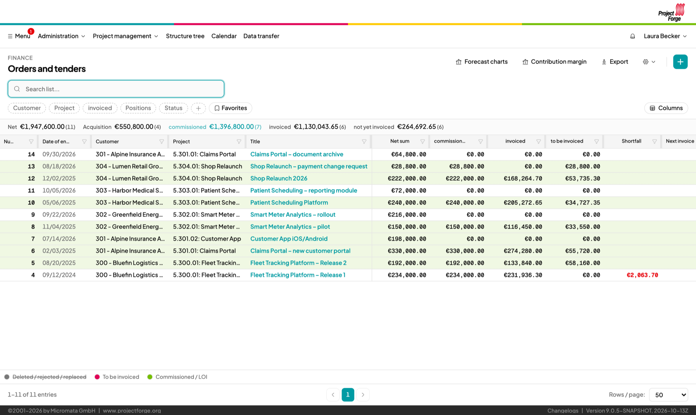 +
Order book
|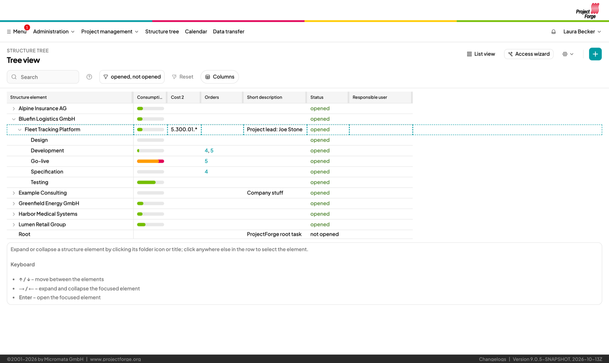 +
Structure tree with consumption bars
|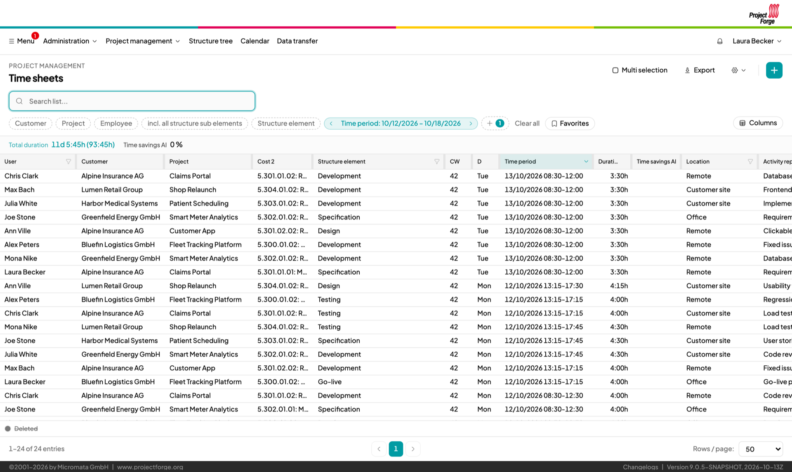 +
Time sheets
|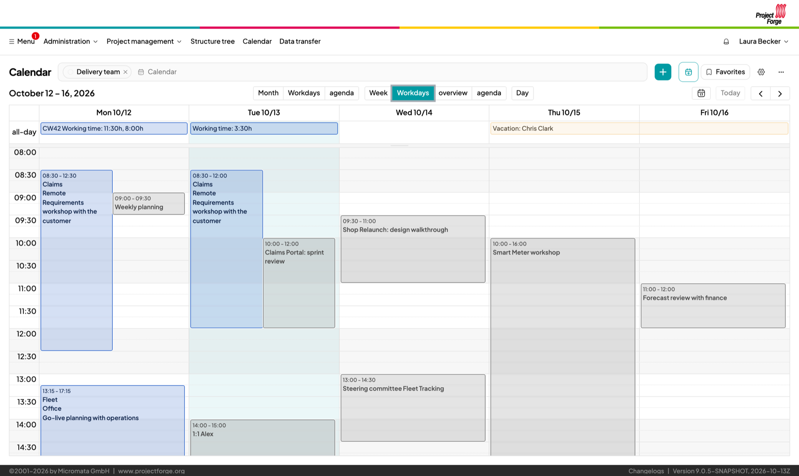 +
Team calendar
|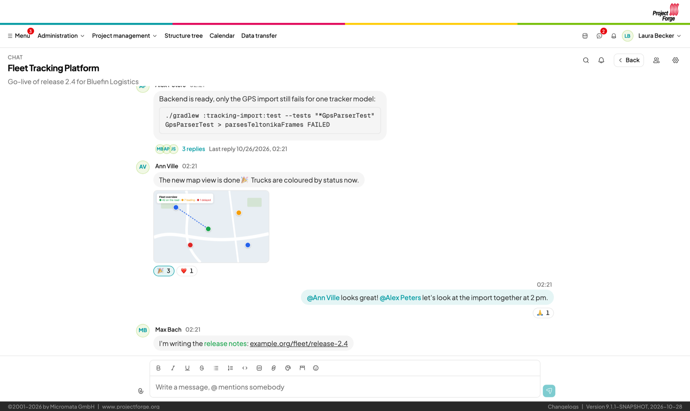 +
Chat
|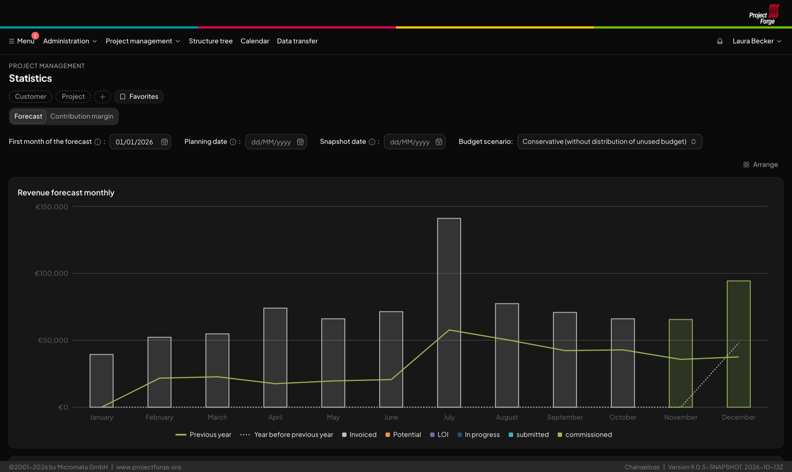 +
Dark theme
|===

=== Mobile app for iPhone and iPad

The ProjectForge app (iOS) will be available in the Apple App Store soon.

[cols="4*^a", frame=none, grid=none]
|===
|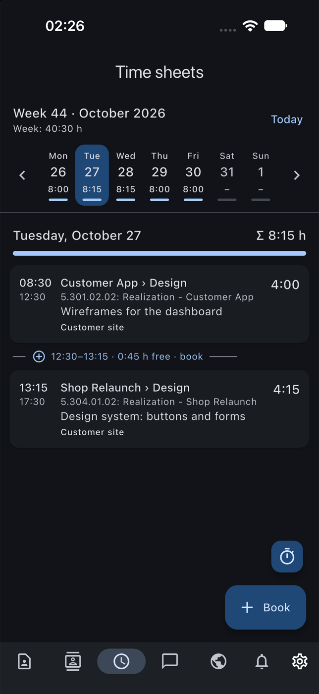 +
Time sheets
|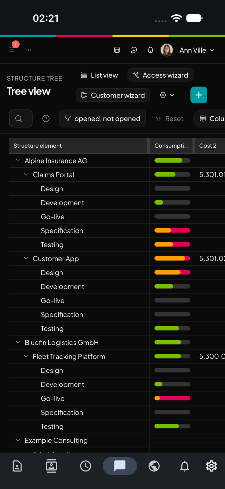 +
Structure tree
|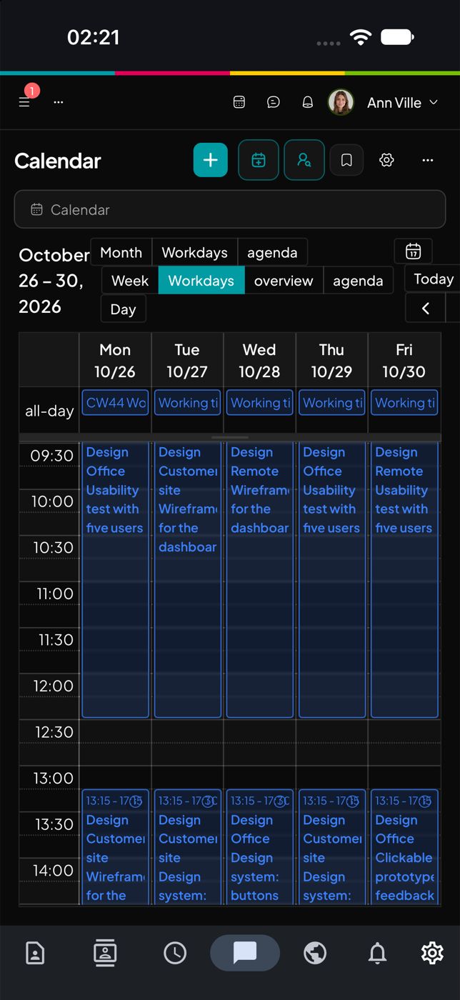 +
Calendar
|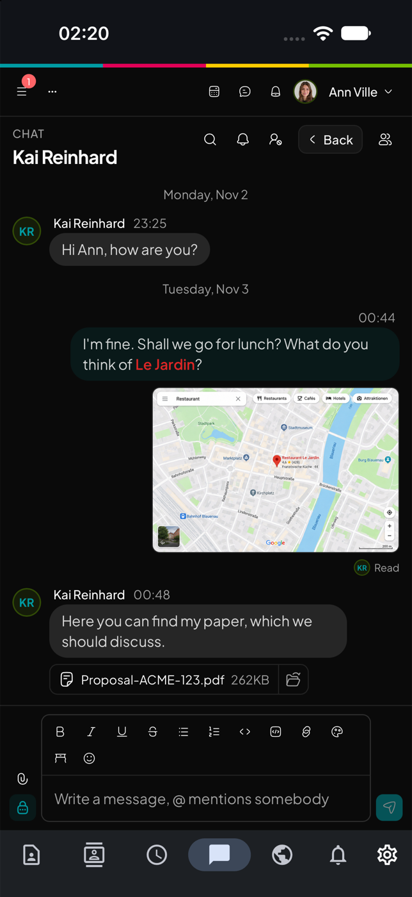 +
Chat
|===

[cols="2*^a", frame=none, grid=none]
|===
|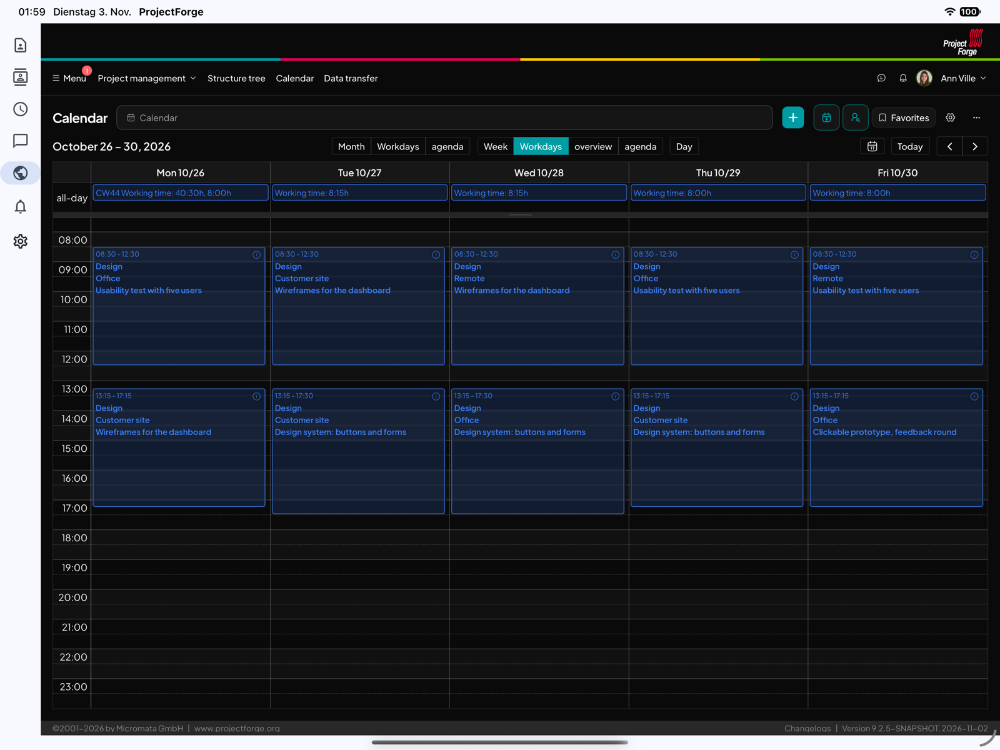 +
Calendar on the iPad
|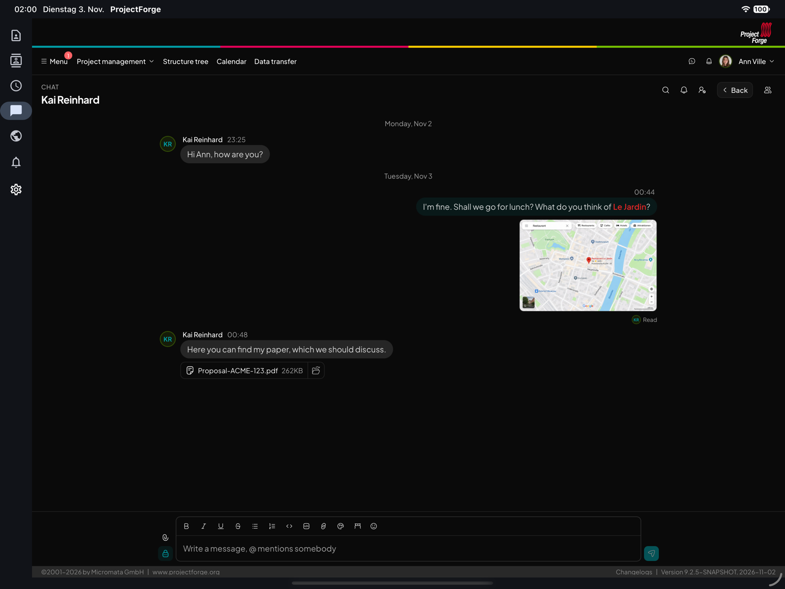 +
Chat on the iPad
|===

== Documentation

* https://projectforge.org/[projectforge.org]: the complete documentation, including the
  https://projectforge.org/docs/installation/[installation], the https://projectforge.org/docs/userguide/[user guide]
  and the https://projectforge.org/docs/adminguide/[admin guide].
* https://projectforge.org/docs/development/[Development guide]: architecture, backend, REST API, frontend, plugins, tests.
* link:dev-docs/README.md[dev-docs]: reference notes and plans for developers.
* link:changelog/changelog.json[Changelog] and the documentation of the plugins in link:doc[doc].

== Installation

The fastest way is the Docker image or the executable jar, see
https://projectforge.org/docs/installation/[Installation].

If you just want to run ProjectForge, download it from https://sourceforge.net/projects/pforge/ and start it with
`java -jar projectforge-application-X.X.X.jar` (Java 21 or newer).

== Building from source

You only need the following steps for developing ProjectForge.

1. Checkout: `git clone git@github.com:micromata/projectforge.git`
2. Use JDK 21 or newer: `java -version`.
3. Build ProjectForge, including the Next.js frontend in `projectforge-next`: +
   `./gradlew build -x test` (`gradlew.bat` on Windows)
4. Run ProjectForge: +
   `java -jar projectforge-application/build/libs/projectforge-application-X.X.X.jar` or `./gradlew bootRun`
5. Open http://localhost:8080 in your browser.

For several instances side by side, hot reload of the frontend and test data see `bin/pfDev.sh` and the
https://projectforge.org/docs/development/[development guide].

=== IntelliJ

1. Launch IntelliJ IDEA and import the project as Gradle project.
2. Run `./gradlew clean build -x test` once.
3. Start `org.projectforge.start.ProjectForgeApplication` (in `projectforge-application/src/main/java`).

== Configuration

No configuration is needed. When ProjectForge is started for the first time, a console or desktop based wizard
does a quick setup (choose the directory and optionally set some parameters).

To use a different home directory you have several options (*choose your favorite*):

. Create `ProjectForge` as top level directory of your home directory: `$HOME/ProjectForge`, *or*
. Create a directory named `ProjectForge` and put the jar file in it or next to it. ProjectForge detects the folder `ProjectForge` relative to the executed jar, *or*
. Create a directory and pass it as command line parameter: `java -Dhome.dir=yourdirectory -jar projectforge-application-X.X.X.jar`, *or*
. Create a directory and set it as environment variable `PROJECTFORGE_HOME`.

All available parameters are listed in
https://github.com/micromata/projectforge/blob/develop/projectforge-business/src/main/resources/application.properties[application.properties];
own values go into `projectforge.properties` in the home directory. More details are in the
https://projectforge.org/docs/adminguide/[admin guide].

== Quickstart with PostgreSQL (optional)

You may use PostgreSQL instead of the built-in data base.

=== Using PostgreSQL (Podman)

* Choose and set a database password: +
 `export PGPASSWORD=mypassword`
* Run PostgreSQL: +
[source,shell]
----
podman volume create projectforge-pgdata
podman run -d \
  --name projectforge-postgres \
  -p 127.0.0.1:5432:5432 \
  -e POSTGRES_DB=projectforge \
  -e POSTGRES_USER=projectforge \
  -e POSTGRES_PASSWORD=$PGPASSWORD \
  -v projectforge-pgdata:/var/lib/postgresql/data \
  docker.io/library/postgres:17
----
* Configure ProjectForge (see <<Configuration>> for the home directory):

.$HOME/ProjectForge/projectforge.properties
[source,shell]
----
projectforge.base.dir=${user.home}/ProjectForge
spring.datasource.url=jdbc:postgresql://localhost:5432/projectforge
spring.datasource.username=projectforge
spring.datasource.password=${PGPASSWORD}
spring.datasource.driver-class-name=org.postgresql.Driver
----

* Start ProjectForge. For regular operation and backups see the https://projectforge.org/docs/adminguide/[admin guide].

.Helpful Podman commands
|===
|Stop|`podman stop projectforge-postgres`
|Start|`podman start projectforge-postgres`
|Import dump (optional)|`podman exec -i projectforge-postgres psql -U projectforge -d projectforge < ~/ProjectForgeBackup/pf.sql` +
Files dump: `podman exec -i projectforge-postgres pg_restore -U projectforge -d projectforge --no-owner < ~/ProjectForgeBackup/projectforge_files_2026-10-20_02-00.dump` +
Schema `pf_files` (attachments), custom format, so `pg_restore` instead of `psql`. Import it after the main dump and
before starting ProjectForge. If the schema already exists, drop it first (`DROP SCHEMA pf_files CASCADE;`) or add
`--clean --if-exists`. Afterwards run _Administration_ -> _System_ -> _Check system integrity_. See the
https://projectforge.org/docs/adminguide/#restoring_a_backup[admin guide].
|PSQL|`podman exec -it projectforge-postgres psql -U projectforge -d projectforge`
|Reset passwords (optional)|`update t_pf_user_password SET password_hash='SHA{BC871652288E56E306CFA093BEFC3FFCD0ED8872}', password_salt=null; update t_pf_user SET password='SHA{BC871652288E56E306CFA093BEFC3FFCD0ED8872}', password_salt=null, email='m.developer@localhost';` +
password is now `test123`.
|Clear calendar subscriptions (optional)|`update t_calendar set ext_subscription=false where owner_fk != [pk];` +
This is useful for avoiding a lot of external calendar calls of foreign users if your productive data contains a lot of users with calendar subscriptions.
|Uninstall|`podman stop projectforge-postgres` &&
           `podman rm projectforge-postgres` &&
           `podman volume rm projectforge-pgdata`
|===

== Plugins

ProjectForge is extensible by plugins. The built-in plugins live in link:plugins[plugins] as Gradle modules and are
activated by administrators under _Administration_ -> _Plugins_ (a restart is required), or with
`projectforge.plugins.ensure-active=datatransfer` (comma-separated ids) in `projectforge.properties`, see
https://projectforge.org/docs/installation/[Installation].

How to write an own plugin (backend, REST, frontend pages) is described in the
https://projectforge.org/docs/development/[development guide].
