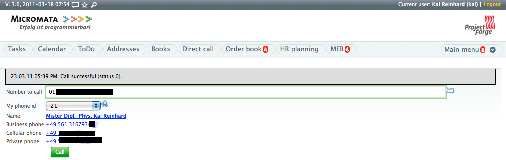
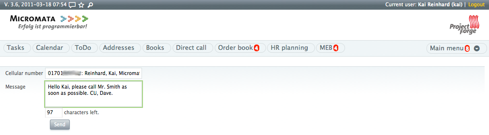
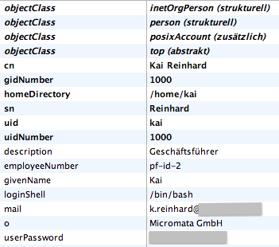
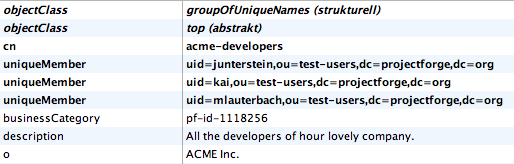
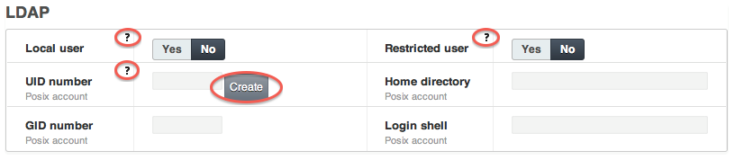
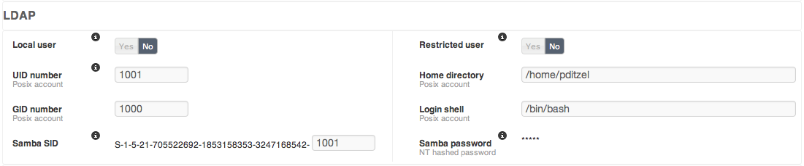

:hide-uri-scheme:

:toc:
:toclevels: 3

:last-update-label: Copyright (C) 2001-2026, Zuletzt aktualisiert

:sectnums:

[[introduction]]
== Einführung

Dieses Dokument beschreibt die Administration von ProjectForge®: Konfiguration, Sicherheit, Benutzerverzeichnisse,
Backups und Wartung. Die Installation von ProjectForge (Docker oder JAR, Einrichtungsassistent, Reverse Proxy) ist
zuvor in link:/docs/installation/[Installation] beschrieben.

Alle hier genannten Einstellungen gehören, sofern nicht anders angegeben, in die Datei `projectforge.properties` im
Home-Verzeichnis von ProjectForge (vom Einrichtungsassistenten angelegt). Die Standardwerte mit Kommentaren sind in
https://github.com/micromata/projectforge/blob/master/projectforge-business/src/main/resources/application.properties[application.properties]
aufgeführt. Nach einer Änderung dieser Datei muss ProjectForge neu gestartet werden.

[[projectforge_setup]]
== ProjectForge einrichten

[[database]]
=== Datenbank

Der Einrichtungsassistent schreibt die Datenbankeinstellungen, daher müssen sie in der Regel nicht angepasst werden.
ProjectForge verwendet den Connection-Pool von Spring Boot (HikariCP); die Standardwerte von `spring.datasource.hikari.*`
stehen in `application.properties`.

[source,properties,linenums]
----
# Eingebettete HSQLDB (Standard, für Tests und kleine Installationen):
spring.datasource.url=jdbc:hsqldb:file:${projectforge.base.dir}/database/projectforge;shutdown=true
spring.datasource.driver-class-name=org.hsqldb.jdbc.JDBCDriver
spring.datasource.username=sa
spring.datasource.password=

# PostgreSQL (empfohlen für den produktiven Einsatz):
#spring.datasource.url=jdbc:postgresql://localhost:5432/projectforge
#spring.datasource.driver-class-name=org.postgresql.Driver
#spring.datasource.username=projectforge
#spring.datasource.password=<your-password>
----

Das Schema wird bei jedem Start automatisch von Flyway angelegt und migriert.

[[initialization_first_login_and_set_up_dialogue]]
=== Initialisierung, erste Anmeldung und Einrichtungsdialog

Nach dem ersten Start zeigt ProjectForge® die Einrichtungsseite. Dort wird das Ziel gewählt (leere Datenbank für ein
Produktivsystem oder ein Testsystem mit Beispieldaten) und Benutzername sowie Passwort des Administrators festgelegt.
Alle weiteren Einstellungen wie Zeitzone und E-Mail-Adressen lassen sich später unter _Administration_ ->
_Konfiguration_ ändern. Details stehen in
link:/docs/installation/#the_setup_page[Installation – The setup page].

[[ssl_https]]
=== SSL / Https

Es empfiehlt sich, ProjectForge auf einem lokalen http-Port zu betreiben und https über einen Reverse Proxy wie NGINX
abzuwickeln, siehe link:/docs/installation/#secure_http_connection_sslhttps[Installation – Secure http connection].

Für Testzwecke lässt sich folgende Konfiguration verwenden:

[[self_signed_certificate]]
==== Selbstsigniertes Zertifikat
Ein selbstsigniertes Zertifikat erzeugen: `keytool -genkeypair -alias selfsigned -keyalg RSA -keysize 2048 -storetype PKCS12 -keystore keystore.p12 -validity 365`

[[configure_the_file_projectforgeprojectforge_properties]]
==== Die Datei `~/ProjectForge/projectforge.properties` konfigurieren

[source,properties,linenums]
----
# An alle Interfaces binden oder an localhost
server.address=0.0.0.0
server.port=8443
server.ssl.key-store=file:/home/projectforge/keystore.p12
server.ssl.key-store-password=<password of your certificate>
server.ssl.key-store-type=PKCS12
----

[[trust_the_self_signed_certificate]]
==== Dem selbstsignierten Zertifikat vertrauen

. Exportieren: `keytool -exportcert -alias selfsigned -keystore keystore.p12 -storetype PKCS12 -file selfsigned.crt -rfc`
. In den Zertifikatsspeicher des Systems oder des Browsers importieren und als vertrauenswürdig markieren.

[[reverse_proxy_security_headers]]
==== Hinter einem Reverse Proxy: sicheres Cookie, HSTS und CSP

Beendet der Reverse Proxy https, sieht ProjectForge selbst nur http-Requests. Dann fehlt dem Session-Cookie das
`Secure`-Flag, und es wird kein `Strict-Transport-Security`-Header (HSTS) gesendet. Das ursprüngliche Protokoll wird
ProjectForge in `~/ProjectForge/projectforge.properties` mitgeteilt:

[source]
----
# Der Proxy muss X-Forwarded-Proto senden (siehe dev-docs/misc/nginx_sites-available_projectforge):
server.forward-headers-strategy=native
# Oder, wenn ohnehin jeder Zugriff über https erfolgt:
#server.servlet.session.cookie.secure=true
----

Seine Sicherheits-Header sendet ProjectForge selbst (Content Security Policy, `X-Frame-Options`, `Referrer-Policy`,
`Permissions-Policy` usw.). Im Proxy sollten sie nicht noch einmal gesetzt werden: Einen doppelt gesendeten Header mit
unterschiedlichen Werten ignoriert der Browser. Die Content Security Policy lässt sich durch einen eigenen Wert von
`projectforge.security.csp-header-value` ersetzen (ein leerer Wert sendet keine, was nicht zu empfehlen ist).

[[reverse_proxy_chat]]
==== Hinter einem Reverse Proxy: Live-Aktualisierung des Chats

Der Chat schickt neue Nachrichten per Server-Sent Events an die geöffneten Unterhaltungen
(`/rs/chat/conversation/{id}/events`), eine lang offene Antwort mit einem Heartbeat alle 25 Sekunden. Der Proxy darf sie
weder puffern noch vor dem nächsten Heartbeat schließen. ProjectForge sendet `X-Accel-Buffering: no`, was nginx
beachtet; nginx braucht daher nur einen Read-Timeout über 25 Sekunden (die Beispielkonfiguration
`dev-docs/misc/nginx_sites-available_projectforge` hat 600 Sekunden). Bei anderen Proxys muss das Puffern für diesen Pfad
abgeschaltet werden. Ohne das funktioniert der Chat trotzdem: Er fragt dann alle paar Sekunden nach neuen Nachrichten.

[[postgresql]]
=== PostgreSQL

[[setting_up_the_database]]
==== Datenbank einrichten

Erforderlich ist PostgreSQL 13 oder neuer: Eine Datenbankmigration (Flyway `V8.0.24`) führt
`CREATE EXTENSION IF NOT EXISTS pg_trgm` für die Trigramm-Indizes der Änderungshistorien-Suche aus. Seit PostgreSQL 13
ist `pg_trgm` eine vertrauenswürdige (trusted) Extension, daher genügt es, wenn der Datenbankbenutzer von ProjectForge
das Recht `CREATE` auf der Datenbank hat (z. B. als deren Eigentümer, siehe unten). Andernfalls muss ein
Datenbankadministrator die Extension einmalig vorab anlegen:
`psql -U postgres -d projectforge -c "CREATE EXTENSION IF NOT EXISTS pg_trgm;"`.

Die Dateien des Dateispeichers liegen in einem eigenen Schema `pf_files`, das ebenfalls von Flyway angelegt wird (der
Datenbankbenutzer braucht also auch das Recht, Schemata anzulegen, das der Eigentümer der Datenbank hat), siehe
<<backup,Backup>>.

. Benutzer anlegen (z. B. als Admin-Benutzer): `createuser -U postgres -P projectforge`
. Datenbank anlegen: `createdb -U postgres -E UTF-8 -O projectforge projectforge`
. Einen vorhandenen Benutzer und eine vorhandene Datenbank löscht man mit: `dropdb projectforge` und `dropuser projectforge`
. Um eine bestehende Datenbank weiterzuverwenden, wird ein Dump eingespielt, siehe <<restoring_a_backup,Backup wiederherstellen>>.

Empfohlene Einstellungen in `postgresql.conf` (`max_connections` muss größer sein als der Connection-Pool von
ProjectForge, `spring.datasource.hikari.maximum-pool-size`, Standard 100):

----
max_connections = 120
statement_timeout =  300000 # 300s
lock_timeout = 300000       # 300s
----

[[configuration]]
== Konfiguration

[[base_directory_applications_home]]
=== Basisverzeichnis (Home-Verzeichnis der Anwendung)

ProjectForge® benötigt ein Home-Verzeichnis, standardmäßig `${user.home}/ProjectForge` (`/ProjectForge` innerhalb von
Docker). Es wird im Einrichtungsassistenten gewählt; wie ProjectForge es findet, steht in
link:/docs/installation/#java_installation_without_docker[Installation]. Folgende Dateien und Verzeichnisse werden
angelegt, falls sie noch nicht existieren:

[width="100%",cols="50%,50%",]
|===
|`projectforge.properties` |Konfigurationsdatei, vom Einrichtungsassistenten geschrieben. Eine frühere `config.xml`
wird beim ersten Start in die Konfigurationsparameter übernommen und in `config.xml.migrated` umbenannt (kann danach
gelöscht werden).

|`database` |Die eingebettete Datenbank (HSQLDB), sofern verwendet.

|`hibernateSearch` |Die Suchindizes (Lucene). Sind sie beschädigt, ProjectForge stoppen, den Inhalt dieses
Verzeichnisses löschen und die Indizes über _Administration_ -> _System_ -> _Reindex_ neu aufbauen.

|`logs` |Die Logdateien, z. B. `ProjectForge.log`.

|`resources` |Eigene Ressourcen, die die mitgelieferten überschreiben: `images` (Logos), `fonts` (für den PDF-Renderer),
`mail` (E-Mail-Vorlagen), Übersetzungen.

|`backup` |Standardverzeichnis für Backups.

|`datatransfer` |Die Dateien der Datentransfer-Bereiche (Plugin _Datentransfer_).

|`jcr` |Das frühere Dokumenten-Repository (JCR), seit 9.2 nicht mehr verwendet. Kann gelöscht werden, siehe <<moving_the_files_out_of_the_jcr,Update einer Installation mit JCR>>.

|`work` |Arbeitsverzeichnis, z. B. für Stände von Synchronisationen.

|`tmp` |Temporäre Dateien, z. B. Debug-Logs.
|===

Die Verzeichnisse `work`, `tmp` und `backup` lassen sich über die Properties `projectforge.dir.work`,
`projectforge.dir.tmp` und `projectforge.dir.backup` an anderer Stelle ablegen (absolut oder relativ zum
Home-Verzeichnis).

[[configuration_file_application_properties]]
=== Konfigurationsdatei application.properties

ProjectForge® ist eine Spring-Boot-Anwendung, daher lassen sich alle
https://docs.spring.io/spring-boot/appendix/application-properties/index.html[common application properties]
in `projectforge.properties` verwenden. Alle ProjectForge-spezifischen Optionen mit ihren Standardwerten stehen in
https://github.com/micromata/projectforge/blob/master/projectforge-business/src/main/resources/application.properties[application.properties].

[[properties_editor]]
==== Properties-Editor

Administratoren bearbeiten die `projectforge.properties` auf der Seite *Administration -> System* (Menü
_Konfiguration_ -> _Konfigurationsdatei_). Der Editor zeigt alle Parameter der `application.properties` nach Themen
gruppiert mit ihren Beschreibungen und Standardwerten. Parameter der eigenen Datei, die ProjectForge nicht kennt, sind
gekennzeichnet: Die im Namensraum von ProjectForge (`projectforge.*`, `pf.*`) werden nicht mehr verwendet (oder sind
vertippt) und stehen in der Gruppe _Nicht mehr verwendet_, wo sie sich auf einmal entfernen lassen; andere (z. B.
Einstellungen von Spring Boot) in der Gruppe _Sonstige_. Passwörter, Schlüssel und Tokens werden nie angezeigt: Ein Geheimnis kann
nur mit einem neuen Wert überschrieben werden.

* Vor jedem Speichern wird eine Kopie der Datei mit Zeitstempel daneben abgelegt
  (`projectforge.properties.<yyyy-MM-dd_HH-mm-ss>.bak`). Die Datei wird nach Gruppen sortiert geschrieben;
  eigene Kommentare bleiben über dem Parameter, über dem sie standen.
* Die Beschreibungen enthalten Links auf die passenden Abschnitte dieses Handbuchs.
* Änderungen werden erst nach einem Neustart von ProjectForge wirksam.
* Ein Wert, den das laufende System anders verwendet (ein Neustart steht aus oder der Wert kommt aus
  einer Umgebungsvariablen oder der Kommandozeile), wird markiert.

[[feature_toggles]]
=== Funktionen abschalten

Funktionen von ProjectForge lassen sich in `projectforge.properties` abschalten (wirksam nach einem Neustart). Eine
abgeschaltete Funktion hat keinen Menüeintrag, und ihre Seiten und REST-Dienste antworten mit 404, für alle.

[source,properties]
----
# Allowlist: all (Standard) oder eine kommagetrennte Liste.
projectforge.features.enabled=all
# Denylist, gewinnt gegen die Allowlist.
projectforge.features.disabled=TIMESHEET_LIST,HR
----

Es gibt eine Funktion je Menüeintrag. Ihre Id ist die des Menüeintrags (`ADDRESS_LIST`, `TIMESHEET_LIST`,
`FEEDBACK`, `MY_ACCOUNT`, ..., siehe `MenuItemDefId`), die des Menüeintrags eines Plugins (`toDo`,
`DataTransferPersonalBox`) oder die eines Plugins (`datatransfer`, `marketing`). Eine Hauptgruppe des Menüs
(`COMMON`, `FIBU`, `HR`, `MISC`, ...) oder ein Plugin steht für alle seine Einträge. Nicht aktivierte Plugins sind
ebenfalls abgeschaltet, samt ihrer REST-Dienste. Unbekannte Ids werden beim Start als Warnung protokolliert.

Das ist kein Berechtigungssystem, die Zugriffsprüfungen der Funktionen bleiben, wie sie sind. Einige Dienste
bleiben auch bei abgeschalteter Funktion erreichbar, weil andere Seiten sie brauchen: die Suchen der Eingabefelder
(etwa nach Benutzern oder Aufgaben), das Abonnieren von Kalendern und der Kern der Anwendung (Anmeldung, Menü,
Einstellungen, Benachrichtigungen, Anhänge der übrigen Funktionen). Auch die Schnittstellen außerhalb der Seiten und
REST-Dienste werden nicht abgeschaltet: CardDAV (`/carddav`), der Export von Kalendern (`/export/ProjectForge.ics`)
und die SMS-Schnittstelle (`/export/sms`).

Die Sichtbarkeit von Menüs (`projectforge.menu.visibility.*`) ist etwas anderes: Sie blendet Menüeinträge nur für
Gruppen von Benutzern aus, die Funktionen bleiben erreichbar.

[[mobile_app]]
=== Mobile App

Die mobile App meldet sich im System-Browser an (Passwort und zweiter Faktor wie im Web) und erhält dann ein eigenes
Token. Einstellungen in der `projectforge.properties`:

[source,properties]
----
# Tage ohne Anfrage, nach denen das Token einer App ungültig ist (Standard 90).
projectforge.app.tokenExpiryDays=90
# Cookies eines SSO-Proxys vor ProjectForge, die an die App übergeben werden (siehe unten).
projectforge.app.proxyCookies=authentik_proxy_*
# Push-Nachrichten (iPhone), siehe unten.
projectforge.push.apns.keyFile=/path/to/AuthKey_ABC1234567.p8
projectforge.push.apns.keyId=ABC1234567
projectforge.push.apns.teamId=DEF1234567
projectforge.push.apns.topic=de.projectforge.mobileapp
----

[[mobile_app_proxy_cookies]]
==== Hinter einem SSO-Proxy

Steht ein SSO-Proxy (z. B. Authentik als Forward Auth in nginx) vor ProjectForge, lässt er nur Anfragen mit seinem
eigenen Sitzungs-Cookie durch. Der Browser hat dieses Cookie, die App nicht. `projectforge.app.proxyCookies` nennt die
Cookies des Proxys, durch Kommas getrennt; ein abschließendes `*` passt auf ein Präfix (`authentik_proxy_*`). Bei der
Anmeldung im Browser entnimmt der Server diese Cookies der Anfrage und übergibt sie zusammen mit dem Token an die App.
Die App sendet sie mit jeder Anfrage und legt sie in ihre Web-Ansichten.

* Nur die Cookies des Proxys nennen: Ein einzelnes `*` wird ignoriert, und die Cookies von ProjectForge selbst werden
  nie übergeben. Ein Cookie, das der Browser doppelt sendet (z. B. von einer anderen Subdomain), wird nicht
  übernommen.
* Weist der Proxy die App ab (seine Sitzung ist abgelaufen), meldet sich die App erneut im Browser an, was frische
  Cookies bringt und einen zweiten Faktor von ProjectForge erfordert. Die App muss sich daher nach jedem Ablauf der
  Proxy-Sitzung (z. B. der Token-Gültigkeit des Authentik-Providers) neu anmelden.
* Die App erhält die Proxy-Sitzung des Browsers, keine eigene. Bei Forward Auth auf Domain-Ebene kommt sie damit an
  jede Anwendung hinter dem Proxy. Das Abmelden der App unter „Mein Konto“ beendet die Proxy-Sitzung nicht, und eine
  Abmeldung am Proxy im Browser sperrt auch die App aus.

[[mobile_app_push]]
==== Push-Nachrichten

Eine neue Benachrichtigung kann die App über den Push-Dienst von Apple (APNs) mit einer Push-Nachricht wecken. Der
Server sendet sie selbst: Er benötigt dazu einen APNs-Authentifizierungsschlüssel (`AuthKey_<keyId>.p8`) des Apple-
Entwicklerkontos, zu dem die App gehört (`keyFile`, `keyId`, `teamId` und die Bundle-ID der App als `topic`). Ohne
`keyFile` wird keine Push-Nachricht gesendet, und die App fragt wie bisher gelegentlich nach neuen Benachrichtigungen.

Der Schlüssel gehört dem Herausgeber der App. Pushes funktionieren daher für Installationen, die den Schlüssel des
Herausgebers haben oder einen eigenen Build der App. Die Nachricht enthält keinen Inhalt der Benachrichtigung, nur
einen allgemeinen Text, den Link und die Anzahl offener Benachrichtigungen; den Inhalt lädt die App selbst. Debug-Builds
der App nutzen die Sandbox von APNs, Release-Builds den Produktivdienst.

[[customization]]
=== Anpassungen

[[logo_and_title_in_pdf_outputs]]
==== Logo und Titel in PDF-Ausgaben

Unter _Administration_ -> _Konfiguration_ wird der Name der Organisation eingetragen, der z. B. als Überschrift der
PDF-Ausgaben dient.

Logos werden in `projectforge.properties` konfiguriert. Die Dateien müssen in `resources/images` des
Home-Verzeichnisses liegen (oder als absolute Pfade angegeben werden):

[source,properties,linenums]
----
# Logo der Web-App:
projectforge.logoFile=logo.png
# Optionale Variante für den Dark Mode:
projectforge.logoFileDark=logo-dark.png
# Logo in Exporten:
projectforge.export.logoFile=logo-export.png
----

[[customizing_i18n_translations]]
==== i18n-Übersetzungen anpassen

In ProjectForge lässt sich jeder Übersetzungstext der Benutzeroberfläche anpassen oder überschreiben. Das ist nützlich,
um die Begriffe an die Bedürfnisse der eigenen Organisation anzupassen.

So werden Übersetzungen angepasst:

. Eine oder mehrere Properties-Dateien im Verzeichnis `~/ProjectForge/resources` anlegen:
  * `CustomerI18nResources.properties` - für Standard-/englische Übersetzungen
  * `CustomerI18nResources_de.properties` - für deutsche Übersetzungen
  * `CustomerI18nResources_en.properties` - für englische Übersetzungen (explizit)

. Eigene Schlüssel-Wert-Paare eintragen, um bestehende Übersetzungen zu überschreiben oder neue hinzuzufügen:
+
[source,properties,linenums]
----
# Beispiel: bestehende Übersetzung überschreiben
menu.addressList=Contacts
# Beispiel: eigene Übersetzung hinzufügen
myorganization.custom.greeting=Welcome to Acme Corp
----

. ProjectForge neu starten, damit die Änderungen wirksam werden.

Die eigenen Übersetzungen haben Vorrang vor den in ProjectForge enthaltenen Standardübersetzungen.

Die verfügbaren i18n-Schlüssel, die sich überschreiben lassen, finden sich hier:

* Übersetzungen der Hauptanwendung: https://github.com/micromata/projectforge/blob/master/projectforge-business/src/main/resources/I18nResources.properties[I18nResources.properties]
* Übersetzungen der Plugins: im GitHub-Repository nach Dateien `*I18nResources.properties` in den Plugin-Verzeichnissen suchen, z. B.:
** `plugins/org.projectforge.plugins.banking/src/main/resources/BankingI18nResources.properties`
** `plugins/org.projectforge.plugins.skillmatrix/src/main/resources/SkillMatrixI18nResources.properties`
** sowie weitere plugin-spezifische Übersetzungsdateien

[[configuration_settings_web_interface]]
=== Konfigurationseinstellungen (Weboberfläche)

Unter _Administration_ -> _Konfiguration_ lassen sich weitere Parameter von ProjectForge® einstellen, etwa die
Standardzeitzone, die Ländervorwahl oder die Kostenträgerrechnung. Jeder Parameter ist dort erläutert. Strukturierte
Einstellungen sind JSON-Werte, etwa die Feiertage (zusätzliche und Änderungen der mitgelieferten), die JIRA-Server, die
Vertragsarten und die Buchhaltungseinstellungen samt betriebswirtschaftlicher Auswertung (siehe
<<business_assessment_bwa,BWA>>).

_Administration_ -> _System_ bietet unter anderem: die Konfigurationsparameter neu einlesen, die 2FA-Konfiguration
exportieren, den Suchindex neu aufbauen und die Systemintegrität prüfen.

[[using_ttf_fonts_for_pdf_render_engine]]
=== TTF-Schriften für die PDF-Render-Engine verwenden

Als interne Render-Engine für PDF-Ausgaben dient Apache FOP. Zusätzliche Schriften werden in `resources/fonts` des
Home-Verzeichnisses abgelegt (oder in dem mit `projectforge.fontsDirectory` konfigurierten Verzeichnis). Details zu
Schriften stehen in der https://xmlgraphics.apache.org/fop/[FOP-Dokumentation].

[[html_formatted_e_mail_templates]]
=== HTML-formatierte E-Mail-Vorlagen

ProjectForge erzeugt E-Mails (z. B. Benachrichtigungen) mit Groovy-Vorlagen. Die mitgelieferten Vorlagen liegen in
den Quellen unter
https://github.com/micromata/projectforge/tree/master/projectforge-business/src/main/resources/mail[projectforge-business/src/main/resources/mail].
Um eine Vorlage anzupassen, wird sie unter demselben relativen Pfad in das Ressourcenverzeichnis des
Home-Verzeichnisses kopiert, z. B. `~/ProjectForge/resources/mail/orderChangeNotification.html`, und dort bearbeitet.
ProjectForge sucht zuerst dort und greift auf die mitgelieferte Vorlage zurück, wenn die Datei nicht existiert.

Die Vorlagen werden mit der Sprache (Locale) des empfangenden Benutzers internationalisiert.

[source,html,linenums]
----
<html>
#INCLUDE{mail/mailHead.html}
<body>
#INCLUDE{mail/mailOpening.html}
 
Hier kann Inhalt platziert werden (für internationalisierte E-Mails i18n-Schlüssel verwenden).
...
 
<%= pf.getString("link") %>: <a href="${requestUrl}">${requestUrl}</a>
 
Ein Beispiel für dynamische Daten (hier wird eine Liste von Positionen ausgegeben):
<table>
  <% for (position in order.positions) { %>
    <tr>
      <th><%= pf.getString("title") %></th>
      <td>${position.title}</td>
      ...
    </tr>
  <% } %>
</table>

#INCLUDE{mail/mailHistoryTable.html}

#INCLUDE{mail/mailClosing.html}
#INCLUDE{mail/mailFooter.html}
</body>
</html>
----

[[sending_e_mails]]
=== E-Mails versenden

ProjectForge versendet Benachrichtigungen, Mails zum Zurücksetzen des Passworts, 2FA-Codes und den Fehler-Digest per
SMTP:

[source,properties,linenums]
----
mail.session.pfmailsession.emailEnabled=true
mail.session.pfmailsession.standardEmailSender=projectforge@acme.com
# Plain, StartTLS oder SSL:
mail.session.pfmailsession.encryption=StartTLS
mail.session.pfmailsession.smtp.host=mail.acme.com
mail.session.pfmailsession.smtp.port=587
mail.session.pfmailsession.smtp.auth=true
mail.session.pfmailsession.smtp.user=projectforge
mail.session.pfmailsession.smtp.password=<password>
----

[[support_error_digest]]
=== Fehler-Digest für den Support

Ist eine Support-Adresse konfiguriert (`projectforge.support.mail`) und der Mailversand eingerichtet, sammelt
ProjectForge die Fehler eines Zeitraums und schickt sie pro Intervall als eine Digest-Mail an diese Adresse. Für einen
Zeitraum ohne Fehler wird nichts versendet. Der Digest sammelt:

- unerwartete Fehler in Anfragen angemeldeter Benutzer (keine Bedienfehler wie Validierungs- oder Zugriffsfehler),
- geloggte Fehler (Level ERROR),
- nicht erreichbare externe Systeme (LDAP, IdP, Gateway, SMS-/Telefondienste, SMTP, ...), erkannt an
  Verbindungsfehlern und Timeouts, auch aus Warnungen,
- Synchronisationsläufe, die seit dem letzten Digest fehlgeschlagen, abgebrochen oder in einen Timeout gelaufen sind.

Gleiche Fehler (die sich nur in IDs, Zahlen oder zitierten Werten wie einem Benutzernamen unterscheiden) werden
zusammengefasst. Gruppiert eine neue Version sie gröber, werden die zuvor erfassten Probleme kurz nach dem Start
zusammengeführt (Anzahlen summiert, der Status der Administration bleibt erhalten, wenn er übereinstimmt, sonst neu).
Die Mail listet zuerst neue Probleme, Regressionen (Probleme, die nach ihrer Behebung erneut aufgetreten sind) und
Spitzen (deutlich häufiger als in den letzten 7 Tagen), danach die 30 häufigsten bekannten Probleme nach Schweregrad
(nicht erreichbare externe Systeme zuerst). Jedes Problem verlinkt auf das _System-Dashboard_ (Administration), wo es
bestätigt, als behoben markiert, ignoriert oder stummgeschaltet werden kann; ignorierte und stummgeschaltete Probleme
werden nur gezählt. Die angehängte Textdatei enthält pro Gruppe bis zu fünf einzelne Vorkommen mit Benutzer, Anfrage
und Stacktrace.

Für eine Analyse oder Klassifizierung mit einer KI (oder einem anderen Werkzeug) hängt der Digest zusätzlich alles als
JSON-Datei an (`format: projectforge-log-analysis`), und das _System-Dashboard_ lädt alle Probleme seines aktuellen
Filters im selben Format herunter (_Als JSON herunterladen_), mit Beispielmeldung, Stacktrace und den Vorkommen der
letzten 30 Tage. Die Datei erklärt ihre Felder und Werte selbst (`guide`) und kann daher unverändert weitergegeben
werden. Sie enthält keine Benutzernamen, Meldungen und Anfragen sind aber so wie geloggt enthalten und können
personenbezogene Daten enthalten: Das ist vor der Weitergabe an einen externen Dienst zu prüfen.

Ein neues Sicherheits- oder Datenproblem (oder eines, das nach seiner Behebung erneut aufgetreten ist) wartet nicht
auf das Ende des Intervalls: Es löst den Digest vorzeitig aus, sobald es seinen Schwellwert erreicht, höchstens jedoch
alle `urgentMinGap` (Standard: 1 Stunde), auch nachts. Der reguläre Digest wird standardmäßig einmal täglich um 07:00 Uhr versendet.

Jedes Problem geht an die Empfänger seiner Zielgruppe: Entwicklung (Bugs, Datenprobleme), Administration (externe
Systeme, Konfiguration, Synchronisationsläufe) oder Sicherheit. Hat eine Zielgruppe keine eigenen Empfänger, erhält
`projectforge.support.mail` ihren Digest.

.Datei: `projectforge.properties`
----
projectforge.support.mail=support@acme.com
# Wie oft der reguläre Digest versendet wird, z. B. 15m, 1h, 1d. 0 deaktiviert den Digest. Standard: 1d
projectforge.support.errorDigest.interval=1d
# Uhrzeit (HH:mm) des regulären Digests bei einem Intervall von mindestens einem Tag. Leer: ab dem letzten Digest gezählt. Standard: 07:00
projectforge.support.errorDigest.sendAt=07:00
# Mindestabstand vorzeitiger Digests (dringende Probleme), z. B. 5m, 1h. Standard: 1h
projectforge.support.errorDigest.urgentMinGap=1h
# Optional, kommagetrennt, Standard: projectforge.support.mail
projectforge.support.errorDigest.recipients.developer=dev@acme.com
projectforge.support.errorDigest.recipients.admin=ops@acme.com
projectforge.support.errorDigest.recipients.security=security@acme.com
----

[[system_dashboard_and_log_viewer]]
=== System-Dashboard und Log-Viewer

Administratoren finden das _System-Dashboard_ im Menü _Administration_. Es zeigt die für den Fehler-Digest gesammelten
Probleme (siehe oben) und die Läufe der geplanten Jobs und bietet einen Log-Viewer zum Durchsuchen der Logdateien,
einschließlich des Kontexts eines Logeintrags. Die Zählerstände werden in der Datenbank gespeichert
(`projectforge.support.logAggregation.*` und `projectforge.scheduler.stats.*` in `application.properties`, bereinigt
durch den täglichen Datenschutz-Job).

[[phone_calls_and_texting_with_projectforge]]
=== Telefonieren und SMS mit ProjectForge

[[phone_calls]]
==== Telefonieren

Ist es konfiguriert, können Benutzer Anrufe direkt starten, indem sie auf eine Telefonnummer einer Adresse klicken
oder auf der Seite _Direktwahl_ einen Namen oder eine Telefonnummer eingeben. Die Anrufe werden über Sipgate
aufgebaut:

[source,properties,linenums]
----
projectforge.sipgate.baseUri=<base uri of the Sipgate REST API>
projectforge.sipgate.tokenId=<token id>
projectforge.sipgate.token=<token>
# Gerät für Anrufe, falls der Benutzer keine eigenen Sipgate-Geräte konfiguriert hat (z. B. "p2"):
projectforge.sipgate.defaultDevice=
projectforge.sipgate.basePhoneNumber=
----

[cols="1,4",]
|===
|Abbildung 1: |Ein Anruf lässt sich einfach durch einen Klick auf eine Telefonnummer
einer Adresse starten oder durch Eingabe eines Namens oder einer Nummer in das
Nummernfeld.
|===

Nicht vergessen: Die Standard-Ländervorwahl wird unter _Administration_ -> _Konfiguration_ eingestellt.

[[texting]]
==== SMS

Ist ein SMS-Gateway konfiguriert, können Benutzer Textnachrichten versenden, indem sie auf das SMS-Symbol einer
Adresse klicken oder einen Namen bzw. eine Mobilfunknummer eingeben. ProjectForge ruft das Gateway per http auf;
`#number` und `#message` werden durch die Eingaben des Benutzers ersetzt. Die Textnachrichten dienen, sofern
konfiguriert, auch als zweiter Faktor (2FA).

[source,properties,linenums]
----
projectforge.sms.url=https://smsgateway.acme.com/api.php
# GET (Standard) oder POST:
projectforge.sms.httpMethod=GET
projectforge.sms.httpParameters={username:'projectforge',text:'#message',to:'#number'}
# Muster der Gateway-Antwort:
projectforge.sms.returnCodePattern.success=^OK.*
projectforge.sms.returnCodePattern.error=^Error.*
----

[cols="1,4",]
|===
|Abbildung 2: |Textnachrichten lassen sich einfach durch einen Klick auf das SMS-Symbol
einer Adresse versenden oder durch Eingabe eines Namens oder einer Mobilfunknummer.
|===

Alle Optionen stehen in `application.properties` (`projectforge.sms.*`).

[[phone_lookup]]
==== Rufnummernsuche

Über den Dienst zur Rufnummernsuche kann eine Telefonanlage (z. B. Asterisk) den Anrufer eingehender Anrufe ermitteln:
`https://projectforge.acme.com/rsPublic/phoneLookup?nr=<number>&key=<key>`. Falsche Schlüssel werden wie
fehlgeschlagene Anmeldungen verzögert.

Der Dienst ist deaktiviert, solange kein Schlüssel konfiguriert ist (Standard: leer). Zum Aktivieren wird ein eigener,
langer, zufälliger geheimer Schlüssel in `projectforge.properties` gesetzt (z. B. erzeugt mit `openssl rand -hex 32`):

[source,properties,linenums]
----
projectforge.phoneLookupKey=<your-random-secret>
----

[[digital_business_cards]]
=== Digitale Visitenkarten

Nutzer legen ihre Visitenkarten über _Meine Visitenkarten_ im Benutzermenü an: ein QR-Code mit den Kontaktdaten
(vCard) aus einer Adresse. Zwei optionale Funktionen brauchen Konfiguration.

[[business_card_photo]]
==== Foto

Ein Foto ist nicht Teil des QR-Codes, sondern eine öffentliche URL (`/rsPublic/contactImage/<token>`, ohne Anmeldung)
in dessen vCard; es wird nur für die eigene Adresse angeboten. Das Token ist zufällig (256 Bit) und gehört zur Adresse,
die URL lässt sich also nicht erraten und bleibt beim Ersetzen oder Löschen des Bildes gleich (ohne Bild antwortet sie
mit 404; Browser können das alte Bild bis zu eine Stunde zwischenspeichern). Fehlgeschlagene Versuche werden je
Client-Adresse gebremst. Nutzer widerrufen die URL mit _Foto-Link erneuern_ an der Karte (alle Karten der Adresse
erhalten dann eine neue); das Abschalten des Fotos einer Karte widerruft sie nicht. Die Bilder liefern die
Hauptinstanz und das Gateway (das Token wird mit der Adresse übertragen) unter derselben URL aus. Das Gateway sollte zusammen mit der Hauptinstanz aktualisiert werden: Ein altes Gateway kennt
den neuen Pfad nicht und antwortet für die Fotos mit 404.

Die Basis der URL ist, in dieser Reihenfolge: `projectforge.businessCard.photoBaseUrl` (überschreibt alles, z. B. ein
Reverse Proxy), die öffentliche URL des Gateways (`projectforge.gateway.push.publicUrl`, siehe
<<external_gateway_mode>>), die Domain der Instanz (`projectforge.domain`, nicht bei `localhost`). Ohne eine davon gibt
es keine Foto-URL. Für `/rsPublic/contactImage/` sollte im Reverse Proxy ein `limit_req` stehen.

[[business_card_wallet]]
==== Apple Wallet

Mit einem Pass-Type-ID-Zertifikat kann jede Karte zum Apple Wallet hinzugefügt werden (eine `.pkpass`-Datei, keine App
nötig). Das Zertifikat bleibt auf der Hauptinstanz, nie auf dem Gateway. Ohne die Einstellungen wird der Button nicht
angezeigt.

Einmalig pro Installation, mit einem Apple-Developer-Konto:

. Developer-Portal, _Certificates, Identifiers & Profiles_, _Identifiers_, _Pass Type IDs_: eine Pass Type ID anlegen,
  z. B. `pass.com.acme.projectforge.businesscard`. Sie ist unabhängig von den Signaturzertifikaten von Apps.
. In dieser Pass Type ID: _Create Certificate_ mit einem Certificate Signing Request, `pass.cer` herunterladen.
. `pass.cer` in den Schlüsselbund importieren (neben den privaten Schlüssel des Requests) und beides als `pass.p12`
  exportieren.
. Das Zwischenzertifikat _Apple Worldwide Developer Relations - G4_ herunterladen (apple.com/certificateauthority).
. In der `projectforge.properties` konfigurieren:

[source,properties,linenums]
----
wallet.passcertificate.path=/etc/projectforge/wallet/pass.p12
wallet.passcertificate.password=<password of the p12>
wallet.wwdrcertificate.path=/etc/projectforge/wallet/AppleWWDRCAG4.cer
wallet.teamIdentifier=<team id of the developer account>
wallet.passTypeIdentifier=pass.com.acme.projectforge.businesscard
wallet.organizationName=ACME GmbH
# Optional: colors (rgb(r, g, b)) and logo (png) of the pass
wallet.backgroundColor=rgb(255, 255, 255)
wallet.foregroundColor=rgb(33, 37, 41)
wallet.labelColor=rgb(108, 117, 125)
wallet.logoFile=/etc/projectforge/wallet/logo.png
----

Das Zertifikat ist etwa ein Jahr gültig. Vor Ablauf ein neues für dieselbe Pass Type ID erzeugen (Schritte 2 und 3) und
`pass.p12` ersetzen; Pässe, die schon in einem Wallet liegen, funktionieren weiter. Eine neue `.p12` wird beim nächsten
Start gelesen. Ein ausgestellter Pass wird nicht nachträglich aktualisiert: Eine geänderte Karte muss neu hinzugefügt
werden.

[[number_ranges_of_customers_projects_and_cost_units]]
=== Nummernkreise von Kunden, Projekten und Kostenträgern

Kunden und Projekte haben eigene Nummern, jedes Projekt eine systemweit eindeutige Projektnummer. Nummernkreise legen
fest, welche Kunden- und Projektnummern zusammengehören und wie die Kostenträger (Kost2) eines Projekts aus seiner
Nummer abgeleitet werden. Sie werden in `projectforge.properties` konfiguriert (`projectforge.fibu.number-ranges.*`).
Wird keine Kostenträgerrechnung genutzt oder werden keine Kost2 von Projekten benötigt, ist keine Konfiguration nötig:
Kunden- und Projektnummern sind dann frei.

[[which_ranges_apply]]
==== Welche Nummernkreise gelten

Beim Start loggt ProjectForge, welche Nummernkreise gelten (`Number ranges: mode ...`):

[cols="1,4",options="header"]
|===
|Modus |Gilt, wenn
|`CONFIGURED` |Mindestens ein Nummernkreis konfiguriert ist. Es gelten nur die konfigurierten Nummernkreise.
|`LEGACY` |Kein Nummernkreis konfiguriert ist, aber Kost2 von Projekten in den früher fest eingebauten Nummernkreisen
existieren: 4 für interne Projekte (`4.###.##.##`) und 5 für die Kunden 0-999 mit jeweils bis zu 100 Projekten
(`5.###.##.##`). Diese beiden Nummernkreise gelten dann wie bisher. Das wird bei jedem Start erkannt und nicht
gespeichert.
|`FREE` |Sonst (z. B. bei einer neuen Installation). Kunden- und Projektnummern sind frei, Projekte erhalten keine Kost2.
Kost2 ohne Projekt lassen sich weiterhin anlegen.
|===

IMPORTANT: Erhält eine Installation im Modus `LEGACY` ihren ersten konfigurierten Nummernkreis, gelten nur noch die
konfigurierten Nummernkreise. Dann müssen auch die früheren Nummernkreise 4 und 5 konfiguriert werden (siehe Beispiel
unten).

[[settings]]
==== Einstellungen

Jeder Nummernkreis ist ein Listeneintrag `projectforge.fibu.number-ranges.ranges[n].<property>`:

[cols="1,1,4",options="header"]
|===
|Eigenschaft |Standard |Beschreibung
|`prefix` | |Erste Ziffer (1-9) der Projekt- und Kost2-Nummern dieses Nummernkreises, eindeutig über alle Nummernkreise.
|`name` | |Anzeigename, z. B. `Intern`.
|`customer-min`, `customer-max` | |Kleinste und größte Kundennummer dieses Nummernkreises; beide oder keine angeben. Ein
Nummernkreis ohne Kunden ist für Projekte ohne Kunden gedacht (z. B. interne Projekte); sein `project-digits` muss 5
sein.
|`project-digits` |2 |Anzahl der Stellen der Projektnummer je Kunde (1-5) bzw. des gesamten Nummernkreises bei einem
Nummernkreis ohne Kunden.
|`segments` |`1,3,2,2` |Segmente der 8-stelligen Kost2 für Anzeige und Eingabe, z. B. `1,4,1,2` für `1.####.#.##`.
Muss mit 1 beginnen, mit 2 enden (die Kost2-Art) und in der Summe 8 ergeben.
|===

Globale Einstellungen:

[cols="1,1,4",options="header"]
|===
|Eigenschaft |Standard |Beschreibung
|`projectforge.fibu.number-ranges.allow-free-numbers` |`true` |Bei `false` muss jede Kundennummer in einem
konfigurierten Nummernkreis liegen (schützt vor Tippfehlern), und ein Projekt braucht einen Kunden eines
Nummernkreises oder gehört zum Nummernkreis ohne Kunden; gilt auch für die früheren Nummernkreise 4 und 5.
|`projectforge.fibu.number-ranges.default-segments` |`1,3,2,2` |Segmente der Kost2, deren erste Ziffer zu keinem
Nummernkreis gehört (Kost2 ohne Projekt).
|===

[[project_and_kost2_numbers]]
==== Projekt- und Kost2-Nummern

Ein Projekt eines Nummernkreises erhält eine 6-stellige Projektnummer, seine Kost2 sind diese Nummer gefolgt von der
2-stelligen Kost2-Art:

----
project number = prefix * 100000 + (customer mod 10^(5 - project-digits)) * 10^project-digits + project
project number = prefix * 100000 + project                      (range without customers)
Kost2          = project number * 100 + Kost2 type
----

Die Kundennummer selbst ist Teil der Projektnummer: ihre letzten `5 - project-digits` Stellen, unabhängig von
`customer-min`. Beispiel: Nummernkreis 1 mit den Kunden 10000-19999 (oder 10001-19999), 1 Projektstelle und den
Segmenten `1,4,1,2`. Projekt 3 des Kunden 10007 hat die Projektnummer 100073 (angezeigt als `1.0007.3`), seine Kost2 der
Art 02 ist `1.0007.3.02`. Kunde 123 des Nummernkreises 5 (Kunden 0-999, 2 Projektstellen) erhält `5.123.xx`.

Alle Kunden eines Nummernkreises müssen daher die Stellen vor diesen letzten Stellen gemeinsam haben: Ein Nummernkreis
mit 2 Projektstellen umfasst höchstens die 1000 Kunden eines Blocks wie 0-999 (100 Projekte je Kunde), einer mit
1 Projektstelle höchstens die 10000 Kunden eines Blocks wie 10000-19999.

.Datei: `projectforge.properties`
[source]
----
# Früherer Nummernkreis 4: interne Projekte 4.###.##.##
projectforge.fibu.number-ranges.ranges[0].prefix=4
projectforge.fibu.number-ranges.ranges[0].name=Intern
projectforge.fibu.number-ranges.ranges[0].project-digits=5
# Früherer Nummernkreis 5: Kunden 0-999 mit jeweils bis zu 100 Projekten, 5.###.##.##
projectforge.fibu.number-ranges.ranges[1].prefix=5
projectforge.fibu.number-ranges.ranges[1].customer-min=0
projectforge.fibu.number-ranges.ranges[1].customer-max=999
projectforge.fibu.number-ranges.ranges[1].project-digits=2
# Kunden 10000-19999 mit jeweils bis zu 10 Projekten, 1.####.#.##
projectforge.fibu.number-ranges.ranges[2].prefix=1
projectforge.fibu.number-ranges.ranges[2].customer-min=10000
projectforge.fibu.number-ranges.ranges[2].customer-max=19999
projectforge.fibu.number-ranges.ranges[2].project-digits=1
projectforge.fibu.number-ranges.ranges[2].segments=1,4,1,2
# Optional: Kundennummern außerhalb dieser Nummernkreise ablehnen
projectforge.fibu.number-ranges.allow-free-numbers=false
----

[[notes]]
==== Hinweise

* Eine inkonsistente Konfiguration (Präfix doppelt vergeben, überlappende Kundennummern, zu viele Kunden für die
  Projektstellen, ungültige Segmente) bricht den Start mit einer Meldung ab, die den Nummernkreis nennt.
* Neuen Kunden und Projekten wird die nächste freie Nummer ihres Nummernkreises vorgeschlagen.
* Ein Projekt, dessen Kunde zu keinem Nummernkreis gehört, erhält eine freie Projektnummer, die nicht im
  Projektnummernbereich eines Nummernkreises liegen darf (z. B. 100000-199999 für Präfix 1). Solche Projekte und
  Projekte im Modus `FREE` können keine Kost2 erhalten.
* Kost2 ohne Projekt dürfen nicht mit dem Präfix eines Nummernkreises beginnen: Die Kost2 eines Nummernkreises sind die
  seiner Projekte.
* Gespeicherte Projekt- und Kost2-Nummern werden nicht umnummeriert, wenn ein Nummernkreis später geändert wird.
  Bestehende Kost2 bleiben gültig, auch wenn ihr Nummernkreis nicht mehr konfiguriert ist; neue Nummernkreise
  (Kundennummern und Projektstellen) sollten trotzdem vor ihrer Verwendung geplant werden.
* Fakturierungsquote (`projectforge.invoicing-quota.*`): Die Muster beziehen sich auf die Kost2-Nummern in der
  Segmentierung ihres Nummernkreises (z. B. `1.*` für `1.####.#.##`). Mit
  `projectforge.invoicing-quota.billed-by-invoiced-kost2-types=true` zählt die auf Kost2 von Kundenprojekten mit einer
  fakturierten Kost2-Art gebuchte Zeit als abgerechnet, unabhängig von den Ziffern.

[[group_nomenclature]]
=== Nomenklatur der Gruppen

Der Konfigurationsparameter *Nomenklatur der Gruppen* (`groupNomenclature`, Kategorie Finanzen) beschreibt, wie
Gruppen benannt werden. Er ist eine Beschreibung, keine Regel: Projekt- und Strukturelement-Assistent schlagen die
Namen neuer Gruppen danach vor, und die Beschreibung wird am Namen einer Gruppe und in den Assistenten angezeigt;
geprüft wird kein Name.

* *Beschreibung*: Rich Text, der die Konvention erläutert.
* *Muster des Basisnamens* der Gruppen eines Projekts, mit den Platzhaltern `+{customer.identifier}+`,
  `+{customer.name}+`, `+{customer.number}+`, `+{project.identifier}+`, `+{project.name}+` und `+{project.number}+`.
  Ein leerer Kurzbezeichner wird durch den Namen ersetzt. Leer: der Name des Projekts.
* *Endungen* der Gruppen für Management, Team und Externe, mit Bindestrich angehängt. Leer: die Vorgabe des
  Assistenten (`pm`, keine, `extern`).
* *Groß-/Kleinschreibung* des ganzen vorgeschlagenen Namens: unverändert, klein oder groß.

Beispiel: Muster `+{customer.identifier}-{project.identifier}+`, Endungen `pm` und `extern`, Kleinschreibung ergeben
`acme-portal-pm`, `acme-portal` und `acme-portal-extern`. Der Strukturelement-Assistent nimmt das Muster, wenn das
gewählte Element zu einem Projekt gehört, sonst den Titel des Elements.

[[business_assessment_bwa]]
=== Betriebswirtschaftliche Auswertung / BWA

Wer mit Buchungssätzen (DATEV) arbeitet, möchte vermutlich auch betriebswirtschaftliche Auswertungen (BWA) nutzen.
Sie werden im Konfigurationsparameter _Buchhaltung_ (`fibu.accounting`, Element `businessAssessment`) konfiguriert.
Die betriebswirtschaftlichen Auswertungen von
DATEV bestehen aus Zeilen. Jede Zeile hat eine Zeilennummer (no) und einen Titel (für die Anzeige). Der
`accountRange` legt fest, welche DATEV-Konten zur Zeile gehören. Ein Buchungssatz wird dabei der ersten passenden
Zeile zugeordnet. +
Ist die Priorität einer Zeile nicht hoch, wird die Zeile in der Kurzform der betriebswirtschaftlichen Auswertung
nicht angezeigt. Der Wert definiert berechnete Zeilenbeträge: eine Formel aus Zeilen-Ids, beginnend mit `=`, oder ein
Groovy-Skript, das den Betrag liefert. Auch die Kontenbereiche der Debitoren und Kreditoren gehören zu diesem
Parameter. Beispiel:

[source,json]
----
{
  "debitorsAccountNumberRanges": "10000-12999",
  "creditorsAccountNumberRanges": "70000-79999",
  "businessAssessment": {
    "heading": "BWA",
    "overallPerformance": "gesamtleistung",
    "merchandisePurchase": "matWareneinkauf",
    "preliminaryResult": "vorlaeufigesErgebnis",
    "rows": [
      {"no": "1020", "id": "umsatzErloese", "accountRange": "4000-4799", "priority": "MIDDLE", "title": "Umsatzerlöse", "indent": 1},
      {"no": "1051", "id": "gesamtleistung", "value": "=umsatzErloese", "priority": "HIGH", "title": "Gesamtleistung"},
      {"no": "1060", "id": "matWareneinkauf", "accountRange": "5700-5999", "priority": "HIGH", "title": "Mat./Wareneinkauf"},
      {"no": "1380", "id": "vorlaeufigesErgebnis", "value": "=gesamtleistung+matWareneinkauf", "priority": "HIGH", "title": "Vorläufiges Ergebnis"},
      {"id": "relativePerformance", "value": "if (gesamtleistung != 0.0) { return vorlaeufigesErgebnis / gesamtleistung } else { return 0.0 }", "priority": "HIGH", "title": "relative Performance", "scale": 4}
    ]
  }
}
----

[[securityconfig]]
=== Sicherheitskonfiguration

[[secure_passwords]]
==== Sichere Passwörter

Passwörter werden nie im Klartext gespeichert: Jedes Passwort wird zusammen mit einem zufälligen Salt pro Benutzer
und einem Pepper (siehe unten) gehasht. Die Mindestlänge von Passwörtern und die Anzahl der Zeichenklassen, aus
denen ein Passwort Zeichen enthalten muss (Großbuchstaben, Kleinbuchstaben, Ziffern, Sonderzeichen, z. B. 3 von 4),
werden unter _Administration_ -> _Konfiguration_ eingestellt.

[[protection_against_brute_force_attacks]]
==== Schutz vor Brute-Force-Angriffen

Schlägt eine Anmeldung fehl (über die Anmeldeseite oder einen REST-Dienst), wird für den Benutzernamen und für die
IP-Adresse des Clients eine Strafzeit gesetzt. Mit jeder weiteren fehlgeschlagenen Anmeldung wächst die Strafzeit,
und während der Strafzeit wird kein neuer Versuch angenommen. Die Strafzeit für IP-Adressen wächst deutlich langsamer,
damit viele Benutzer hinter demselben NAT nicht ausgesperrt werden. Details stehen im Quellcode (`LoginProtection`).

Die IP-Adresse des Clients wird nur bei Anfragen von einem vertrauenswürdigen Proxy aus `X-Forwarded-For` übernommen
(`projectforge.security.trustedProxies`, Standard: localhost und die privaten Netze).

[[salted_passwords_with_pepper]]
==== Gesalzene Passwörter mit Pepper

Ein Pepper-String wird in `projectforge.properties` konfiguriert; der Einrichtungsassistent erzeugt einen zufälligen.
Vor dem Hashen eines Passworts wird der Pepper mit dem Salt und dem Passwort verkettet, sodass ein Datenbank-Dump allein
für einen Brute-Force-Angriff nicht ausreicht.

[source,properties,linenums]
----
projectforge.security.passwordPepper=*******SECRET********
----

Dieser Wert muss sicher aufbewahrt werden: Geht der Pepper verloren oder wird er geändert, kann sich kein Benutzer mehr
anmelden, dessen Passwort mit dem früheren Pepper gehasht wurde. Dasselbe gilt für
`projectforge.security.authenticationTokenEncryptionKey`, mit dem die Authentifizierungs-Tokens der Benutzer
verschlüsselt werden (eine Änderung macht nur die Tokens ungültig, nicht die Passwörter).

[id=2fa_two_factor_authentication]
==== 2FA (Zwei-Faktor-Authentifizierung)

2FA (Zwei-Faktor-Authentifizierung) wird unterstützt durch:

 * Authenticator-Apps (TOTP, RFC 6238), z. B. Google oder Microsoft Authenticator,
 * WebAuthn/FIDO2 (Sicherheitsschlüssel wie YubiKey),
 * per E-Mail oder Textnachricht (SMS, sofern konfiguriert) gesendete Codes.

Jeder Benutzer richtet seine zweiten Faktoren unter _Mein Zugang_ ein.

Für welche URLs ein zweiter Faktor erforderlich ist und wie lange eine erfolgreiche 2FA gültig bleibt, wird über
Kürzel für vordefinierte Mengen von URI-Matchern und/oder eigene reguläre Ausdrücke festgelegt.
Ein Webfilter prüft bei jeder Anfrage, ob eine 2FA erforderlich ist und ob die letzte erfolgreiche 2FA der aktuellen
Session älter als die festgelegte Gültigkeitsdauer ist.
Der Zeitpunkt einer erfolgreichen 2FA wird sowohl in der Session des Benutzers als auch in seiner
Angemeldet-bleiben-Session gespeichert.

Empfohlene Beispielkonfiguration:

.Datei: `projectforge.properties`
[source,properties,linenums]
----
projectforge.2fa.expiryPeriod.minutes1=
projectforge.2fa.expiryPeriod.minutes10=PASSWORD
projectforge.2fa.expiryPeriod.hours1=ADMIN_WRITE;MY_ACCOUNT
projectforge.2fa.expiryPeriod.hours8=ADMIN;SCRIPT_WRITE;FINANCE_WRITE;ORGA_WRITE;HR_WRITE
projectforge.2fa.expiryPeriod.days30=HR;FINANCE;ORGA;SCRIPT
projectforge.2fa.expiryPeriod.days90=
# Anzahl der Tage, nach denen eine 2FA erforderlich ist, wenn "angemeldet bleiben" genutzt wird. Ohne "angemeldet
# bleiben" und wenn gesetzt, ist nach jeder Anmeldung eine 2FA erforderlich.
projectforge.2fa.loginExpiryDays=30
# Optional: keine E-Mail als zweiter Faktor für Mitglieder dieser Gruppen (kommagetrennt):
projectforge.2fa.disableMail2FAForGroups=PF_Admin
----

Regeln

* Ein Ausdruck, der mit `/` beginnt, ist ein absoluter Pfad der URI und wird als Präfix verglichen: `/rs/user` ->
`^/rs/user.+++*+++`, es passt also jede URI, die mit `/rs/user` *beginnt*.
* Leere Einträge bedeuten: kein zweiter Faktor.
* Reguläre Ausdrücke und Kürzel werden durch `;` getrennt.
* Unterstützte Kürzel sind `ALL`, `ADMIN`, `ADMIN_WRITE`, `FINANCE`, `FINANCE_WRITE`, `HR`, `HR_WRITE`, `ORGA`, `ORGA_WRITE`,
`SCRIPT`, `SCRIPT_WRITE`, `MY_ACCOUNT` und `PASSWORD`; jedes umfasst eine Reihe regulärer Ausdrücke.
* Mit `WRITE:<entity-name>` lassen sich nur die schreibenden Aufrufe einer Entität (REST-Aufrufe) angeben.
Das Lesen von Entitäten bzw. die Detailansicht ist davon nicht betroffen. Für alle Aktivitäten einer Entität wird
stattdessen `/rs/<entity-name>` verwendet.
* Eigene Ausdrücke sind ebenfalls möglich, z. B.: `ADMIN;/rs/report;WRITE:user`
* Passt eine URI zu mehreren Zeiträumen, gilt der kürzeste.
* Das frühere Wicket-Frontend (`/wa/...`) gibt es nicht mehr; seine URLs werden nur noch in das neue Frontend
umgeleitet, Ausdrücke mit `/wa/` schützen also nichts mehr. Sie sind durch die `/rs/...`-Pfade der Entitäten zu
ersetzen.

____
Zur Überprüfung der Konfiguration dient _Administration_ -> _System_ -> _Export 2FA configuration_.
____

[[ldap]]
=== LDAP

[[requirements]]
==== Voraussetzungen

Das LDAP muss die folgenden zusätzlichen Schemata unterstützen (Beispiel aus der
slapd.conf von OpenLDAP):

[source,shell,linenums]
----
include /etc/openldap/schema/cosine.schema
include /etc/openldap/schema/inetorgperson.schema
----

[[configuration_2]]
==== Konfiguration

Die Einstellung groupBase wird nur im Master-Modus benötigt. Der managerUser wird im einfachen Slave-Modus nicht
benötigt. Weitere Informationen folgen unten.

.Datei: `projectforge.properties`
[source,shell,linenums]
----
...
projectforge.ldap.server=
projectforge.ldap.baseDN=
projectforge.ldap.managerUser=
projectforge.ldap.managerPassword=
projectforge.ldap.port=
projectforge.ldap.sslCertificateFile=
projectforge.ldap.groupBase=
projectforge.ldap.userBase=
projectforge.ldap.authentication=
projectforge.ldap.posixAccountsDefaultGidNumber=
projectforge.ldap.sambaAccountsSIDPrefix=
projectforge.ldap.sambaAccountsPrimaryGroupSID=
...
----

[[local_admin_users]]
==== Lokale (Admin-)Benutzer

Zunächst als Administrator mit der Option „Angemeldet bleiben“ der Anmeldeseite anmelden (noch ohne konfiguriertes
LDAP). Dann ProjectForge mit konfiguriertem LDAP neu starten und denselben Browser verwenden: Die Anmeldung sollte
bestehen bleiben. Jetzt jeden Benutzer bearbeiten, der gegen ProjectForge (statt gegen LDAP) authentifiziert werden
soll, die Option _Lokale:r Benutzer:in_ aktivieren und speichern. Danach können sich die lokalen Benutzer ohne
LDAP-Zugangsdaten anmelden. Das ist besonders für Administratoren von ProjectForge nützlich.

[[ldap_over_ssl]]
==== LDAP über SSL

`openssl s_client -showcerts -connect ldap.acme.internal:636 > ldap.pem` Die Zeilen
von `-----BEGIN CERTIFICATE-----` bis einschließlich `-----END CERTIFICATE-----`
in eine Datei namens `ldap.cert.` kopieren. Anschließend lässt sich die Zertifikatsdatei
in `projectforge.properties` konfigurieren oder das Zertifikat in den Java-Keystore
importieren. Die erste Variante ist unabhängig von der Java-Version
und wird bevorzugt empfohlen.

[[projectforge_as_ldap_master]]
==== ProjectForge als LDAP-Master

Der LDAP-Master-Modus ist der am besten getestete LDAP-Modus von ProjectForge und wird von uns produktiv eingesetzt.
In diesem Modus benötigt ProjectForge einen LDAP-Benutzer mit Schreibzugriff auf Gruppen und Benutzer. Die Benutzer
von ProjectForge werden ins LDAP synchronisiert. Bei Konflikten zwischen LDAP und ProjectForge gelten die
Einstellungen von ProjectForge. Die Konfiguration dieses Modus ist einfach:

.Datei: `projectforge.properties`
[source,shell,linenums]
----
...
projectforge.login.handlerClass=LdapMasterLoginHandler
...
----

. Dieser LDAP-Login-Handler hat Lese- und Schreibzugriff auf den LDAP-Server und
ist Master der Benutzer- und Gruppendaten. Alle Änderungen an Benutzern und Gruppen
in ProjectForge werden durchgeschrieben.
. Änderungen auf dem LDAP-Server werden ignoriert und können
von ProjectForge überschrieben werden.
. *Passwörter*  +
Nach jeder erfolgreichen Anmeldung bei ProjectForge (über die Anmeldeseite) versucht
ProjectForge, den Benutzer mit den angegebenen Zugangsdaten (Benutzername/Passwort)
am LDAP zu authentifizieren. Schlägt die LDAP-Authentifizierung fehl, setzt
ProjectForge das Passwort auf das aktuelle Passwort des Benutzers
(auf der Anmeldeseite eingegeben). Ändert der Benutzer sein Passwort (_Passwort ändern_), wird das LDAP-Passwort
entsprechend geändert. Im LDAP-Master-Modus kann der Benutzer außerdem sein „WLAN/Samba-Passwort“ ändern
(_WLAN/Samba Passwort ändern_). Das dort eingegebene Passwort
wird in das LDAP-Attribut „sambaNTPassword“ geschrieben.
. *Deaktivierte Benutzer*  +
Deaktivierte Benutzer werden in eine Unter-Userbase namens „deactivated“ verschoben.
Die E-Mail-Adresse wird ungültig gemacht und das Passwort gelöscht. Gelöschte
und deaktivierte Benutzer werden aus allen LDAP-Gruppen entfernt. Nach der
Reaktivierung wird das Passwort wieder gesetzt, sobald sich der Benutzer
das nächste Mal über die Anmeldeseite anmeldet.
. *Gelöschte Benutzer*  +
Gelöschte Benutzer werden nicht synchronisiert und, falls vorhanden, im LDAP entfernt.
. *Neue Benutzer*  +
Neue Benutzer (auf der Benutzer-Bearbeitungsseite von ProjectForge angelegt) werden
zunächst ohne Passwort, aber mit „WLAN/Samba-Passwort“ direkt im LDAP-System angelegt.
Solche Benutzer müssen sich zuerst bei ProjectForge anmelden, sonst ist
ihr LDAP-Passwort nicht gesetzt (eine Anmeldung an anderen Systemen, die
an das LDAP angebunden sind, ist bis zur ersten Anmeldung bei
ProjectForge nicht möglich).
. *Felder im LDAP ändern*  +
ProjectForge ändert nur unterstützte Felder bekannter LDAP-Benutzer. Werden im LDAP
Felder von Benutzern/Gruppen geändert, die ProjectForge bekannt sind, überschreibt
ProjectForge sie beim nächsten Synchronisationslauf. Änderungen an anderen Feldern
von LDAP-Benutzern lässt ProjectForge unangetastet.
. *Synchronisation*  +
Nach jeder Änderung eines Benutzers oder einer Gruppe in ProjectForge wird die
Synchronisation für alle LDAP-Benutzer und -Gruppen gestartet. Ohne Änderungen
erfolgt die Synchronisation etwa stündlich,
aber nur, wenn in ProjectForge Benutzeraktivität erkannt wird. Eine Synchronisation
lässt sich durch einen Neustart von ProjectForge erzwingen.
. *Gruppen und zugeordnete Benutzer*  +
Benutzer werden als `uniqueMember`-Einträge in die LDAP-Gruppen aufgenommen, wenn sie
auch in ProjectForge derselben ProjectForge-Gruppe zugeordnet sind.

[[ldap_entries]]
===== LDAP-Einträge

Die Abbildungen 3 und 4 zeigen im Detail, wie
ProjectForge LDAP-Felder und Objektklassen speichert und erwartet.

[cols="1,4",]
|===
|Abbildung 3: |ProjectForge verwendet für Benutzer die in dieser Abbildung
gezeigten Felder und Objektklassen. Die Objektklasse `posixAccount` mit den
Feldern `uidNumber, gidNumber, homeDirectory` und `loginShell` wird nur
verwendet und verwaltet, wenn sie konfiguriert ist.
Das Feld `employeeNumber` nutzt ProjectForge, um den
Primärschlüssel des ProjectForge-Benutzereintrags im LDAP zu speichern (für eine bessere
Synchronisation). Dadurch sollte auch das Umbenennen von Benutzernamen funktionieren.
|===

[cols="1,4",]
|===
|Abbildung 4: |ProjectForge verwendet für Gruppen die in dieser Abbildung
gezeigten Felder und Objektklassen. Das Feld `businessCategory` nutzt
ProjectForge, um den Primärschlüssel des ProjectForge-Gruppeneintrags
im LDAP zu speichern (für eine bessere Synchronisation). Dadurch sollte auch das
Umbenennen von Gruppennamen funktionieren.
|===

[[managing_posix_accounts]]
===== POSIX-Accounts verwalten

ProjectForge unterstützt die Verwaltung von POSIX-Accounts mit den
Daten `uidNumber,` `gidNumber,` `homeDirectory,` und `loginShell.`

Die POSIX-Account-Daten lassen sich auf der Benutzer-Bearbeitungsseite pflegen, nachdem
`projectforge.properties` wie im obigen Beispiel konfiguriert wurde.
Weitere Informationen stehen in den Tooltips:

[cols="1,4",]
|===
|Abbildung 5: |ProjectForge kann im LDAP-Master-Modus POSIX-Accounts im LDAP
verwalten.
|===

* Nach einem Klick auf den Button `create` neben dem Feld UID-Nummer
befüllt ProjectForge alle POSIX-Account-Felder vor:
. Die UID-Nummer wird die nächste freie Nummer (ProjectForge sucht die
höchste vergebene UID und erhöht sie um eins). Wird keine solche Nummer gefunden,
wird 1.000 angenommen.
. Die GID-Nummer wird mit `projectforge.ldap.posixAccountsDefaultGidNumber`
aus `projectforge.properties` vorbelegt.
. Das Home-Verzeichnis ist das Präfix `/home/` gefolgt vom Benutzernamen, z. B. `/home/jdoe`
(nicht konfigurierbar).
. Die Login-Shell wird mit `/bin/bash` vorbelegt (nicht konfigurierbar).
+
Nicht vergessen, den Benutzer zu speichern. Nach einer Änderung dieser POSIX-Account-Felder
werden die LDAP-Einträge sofort aktualisiert.
* ProjectForge belegt eine neue UID-Nummer automatisch vor (siehe oben).
* ProjectForge stellt sicher, dass keine UID-Nummer doppelt vergeben wird.
* Ein LDAP-Eintrag erhält die `object-class` `posixAccount` nur, wenn
für diesen Benutzer in ProjectForge POSIX-Account-Daten angelegt wurden.

[[managing_samba_accounts]]
==== Samba-Accounts verwalten

.Datei: `projectforge.properties`
[source,shell,linenums]
----
...
projectforge.ldap.sambaAccountsSIDPrefix=
projectforge.ldap.sambaAccountsPrimaryGroupSID=
...
----

[cols="1,4",]
|===
|Abbildung 6: |ProjectForge kann im LDAP-Master-Modus POSIX- und Samba-Accounts
verwalten.
|===

* Nach einem Klick auf den Button `create` neben dem Feld UID-Nummer
befüllt ProjectForge alle SAMBA-Account-Felder vor:
. Die UID-Nummer wird die nächste freie Nummer (ProjectForge sucht die
höchste vergebene UID und erhöht sie um eins). Wird keine solche Nummer gefunden,
wird 1.000 angenommen.
. Die GID-Nummer wird mit der in `projectforge.properties` konfigurierten
defaultSambaPrimaryGroupSID vorbelegt.
. Parallele Nutzung mit *POSIX, die empfohlen wird:*  +
Den Button 'create' neben der UID des POSIX-Accounts anklicken;
das Suffix der SAMBASID ist dann dieselbe UID. ProjectForge versucht zuerst,
für SAMBA dieselbe UID wie für POSIX zu verwenden, sofern kein Konflikt besteht.
+
Nicht vergessen, den Benutzer zu speichern. Nach einer Änderung dieser Samba-Account-Felder
werden die LDAP-Einträge sofort aktualisiert.
* Ein LDAP-Eintrag erhält die `object-class` `sambaSamAccount` nur, wenn
für diesen Benutzer in ProjectForge Samba-Account-Daten angelegt wurden.

[[projectforge_as_ldap_client]]
==== ProjectForge als LDAP-Client

Dieser LDAP-Login-Handler arbeitet als LDAP-Slave, d. h. auf das LDAP wird
nur lesend zugegriffen. Es gibt 3 Modi:
`simple,` `users` und `users-groups.` Die Konfiguration
dieses Modus ist einfach:

.Datei: `projectforge.properties`
[source,shell,linenums]
----
...
projectforge.login.handlerClass=LdapSlaveLoginHandler
...
----

[[simple_mode]]
===== Einfacher Modus

Der einfache Modus gilt, wenn in `projectforge.properties` kein LDAP-managerUser
angegeben ist.

* Einfach bedeutet, dass nur Benutzername und Passwort geprüft werden; alle anderen
Benutzereinstellungen wie zugeordnete Gruppen, Name usw. werden von
ProjectForge verwaltet.
* Für den Zugriff auf Benutzer oder Gruppen des LDAP ist kein LDAP-Benutzer nötig; nur
Login-Name und Passwort des Benutzers werden durch einen Authentifizierungsversuch geprüft!
* Wird ein Benutzer im LDAP deaktiviert, kann er unbegrenzt mit
ProjectForge weiterarbeiten, solange er die Funktion „Angemeldet bleiben“
nutzt! (Ist das nicht akzeptabel, stattdessen den normalen Benutzermodus
verwenden.)
* Für lokale Benutzer werden alle LDAP-Einstellungen ignoriert.

[[users_mode]]
===== Benutzermodus

Der normale Benutzermodus gilt, wenn in `projectforge.properties` ein LDAP-managerUser
angegeben ist.

* Normal bedeutet, dass Benutzername und Passwort geprüft und alle anderen
Benutzereinstellungen wie der Name usw. über einen angegebenen LDAP-Manager-Benutzer gelesen werden.
* Wird ein Benutzer im LDAP gelöscht, wird er auch in der Datenbank von
ProjectForge als gelöscht markiert. Nach der Synchronisation ist keine Anmeldung mehr möglich
(auch „Angemeldet bleiben“ schlägt für gelöschte Benutzer fehl).
* Für lokale Benutzer werden alle LDAP-Einstellungen ignoriert.
* Alle bekannten LDAP-Benutzerfelder werden synchronisiert (Vorname,
Nachname, E-Mail usw.).

[[users_groups_mode]]
===== Benutzer-Gruppen-Modus

Dieser Modus ist noch nicht implementiert, stattdessen wird der Benutzermodus verwendet.

[[projectforge_without_ldap]]
==== ProjectForge ohne LDAP

ProjectForge lässt sich auch ohne LDAP betreiben (Standard).

.Datei: `projectforge.properties`
[source,shell,linenums]
----
...
projectforge.login.handlerClass=LoginDefaultHandler
...
----

[[oauth2_oidc_authentication]]
=== OAuth2-/OIDC-Authentifizierung

ProjectForge unterstützt die Authentifizierung über einen externen OAuth2-/OIDC-Provider.
Benutzer melden sich beim Identity Provider an (z. B. Authentik, Keycloak) und werden zurück zu ProjectForge
geleitet. Der Benutzer muss in ProjectForge bereits existieren (zugeordnet über `idpExternalId` oder den
Benutzernamen).

[[configuration_3]]
==== Konfiguration

Folgende OAuth2-/OIDC-Client-Konfiguration wird in `projectforge.properties` ergänzt:

[source,properties]
----
spring.security.oauth2.client.registration.authentik.client-id=${AUTHENTIK_CLIENT_ID}
spring.security.oauth2.client.registration.authentik.client-secret=${AUTHENTIK_CLIENT_SECRET}
spring.security.oauth2.client.registration.authentik.scope=openid,profile,email
spring.security.oauth2.client.registration.authentik.authorization-grant-type=authorization_code
spring.security.oauth2.client.registration.authentik.redirect-uri={baseUrl}/login/oauth2/code/{registrationId}
spring.security.oauth2.client.provider.authentik.issuer-uri=${AUTHENTIK_ISSUER_URI}
----

Die Registrierungs-ID muss `authentik` lauten, auch bei anderen Providern wie Keycloak: ProjectForge aktiviert seine
OAuth2-Anmeldung nur, wenn `spring.security.oauth2.client.registration.authentik.client-id` gesetzt ist. Für Keycloak
genügt es, die Issuer-URI des Realms (z. B. `https://auth.acme.com/realms/acme.com`) und den Client von ProjectForge
anzugeben. Die beim Provider zu registrierende Redirect-URI lautet
`https://<your-projectforge-domain>/login/oauth2/code/authentik`.

Die Anmeldeseite von ProjectForge hat keinen Button für den Identity Provider: Benutzer starten die Anmeldung über
`https://<your-projectforge-domain>/oauth2/authorization/authentik` (z. B. als Link oder Lesezeichen oder aus dem
Anwendungs-Dashboard des Identity Providers).

[[user_mapping]]
==== Benutzerzuordnung

Nach einer erfolgreichen OAuth2-Anmeldung ermittelt ProjectForge das lokale Benutzerkonto wie folgt:

. Der OIDC-Claim `sub` wird mit dem Feld `idpExternalId` der ProjectForge-Benutzer verglichen.
. Gibt es keinen Treffer, wird ersatzweise der Claim `preferred_username` mit dem ProjectForge-Benutzernamen verglichen.
. Gibt es weiterhin keinen Treffer, wird die Anmeldung abgelehnt.

Deaktivierte Benutzer werden unabhängig von einer gültigen OAuth2-Session immer abgelehnt.

[[external_gateway_mode]]
==== Externer Gateway-Modus

ProjectForge kann als reduzierte, öffentlich erreichbare Instanz laufen, die *ausschließlich* über OAuth2/OIDC
authentifiziert. In diesem Modus stehen nur folgende Dienste zur Verfügung:

* CardDAV (Adressbuch-Synchronisation)
* CalDAV / ICS-Abonnements (Kalenderexport)
* DataTransfer (Bereiche für den Dateiaustausch)

Aktiviert wird er mit dem Spring-Profil `external-gateway`:

[source,shell]
----
--spring.profiles.active=external-gateway
----

[[minimal_gateway_configuration]]
===== Minimale Gateway-Konfiguration

Die `projectforge.properties` der Gateway-Instanz benötigt den Gateway-Modus und die Datenbankverbindung.
Alle anderen Gateway-Einstellungen (CardDAV, die abgeschalteten Funktionen, siehe <<feature_toggles>>) liefert
das Profil `external-gateway` automatisch. Auch ohne das Profil schaltet der Gateway-Modus alle Funktionen außer
dem Datentransfer ab.

Die OAuth2-/OIDC-Konfiguration wird nur für die DataTransfer-Oberfläche benötigt: CardDAV und CalDAV/ICS
authentifizieren über Tokens und funktionieren ohne sie. Ist der OAuth2-Client nicht konfiguriert, startet das
Gateway ohne Anmeldemöglichkeit.

NOTE: ProjectForge fügt die `projectforge.properties` des Home-Verzeichnisses als `--spring.config.additional-location`
hinzu, die Spring mit höchster Priorität lädt. Sie überschreibt daher das Profil `external-gateway`; diese Datei
sollte sich deshalb auf die folgenden Einstellungen beschränken, statt Standardwerte des Profils zu wiederholen.

[source,properties]
----
# Öffentliche URL des Gateways, einschließlich Port, falls er direkt veröffentlicht wird.
# Das ist die {baseUrl} der unten stehenden OAuth2-Redirect-URI.
projectforge.domain=https://gateway.example.com

# Gateway-Modus
projectforge.gateway.enabled=true
projectforge.gateway.sync.secret=<shared-secret>

# PostgreSQL (Host/Zugangsdaten an die eigene Umgebung anpassen)
spring.datasource.url=jdbc:postgresql://postgres:5432/projectforge
spring.datasource.driver-class-name=org.postgresql.Driver
spring.datasource.username=projectforge
spring.datasource.password=<your-password>

# Erforderlich: Die von der Hauptinstanz übertragenen DAV- und Kalender-Tokens werden verschlüsselt gespeichert.
projectforge.security.authenticationTokenEncryptionKey=<your-key>

# OAuth2/OIDC (nur für die DataTransfer-Oberfläche erforderlich)
spring.security.oauth2.client.registration.authentik.client-id=${AUTHENTIK_CLIENT_ID}
spring.security.oauth2.client.registration.authentik.client-secret=${AUTHENTIK_CLIENT_SECRET}
spring.security.oauth2.client.registration.authentik.scope=openid,profile,email
spring.security.oauth2.client.registration.authentik.authorization-grant-type=authorization_code
spring.security.oauth2.client.registration.authentik.redirect-uri={baseUrl}/login/oauth2/code/{registrationId}
spring.security.oauth2.client.provider.authentik.issuer-uri=${AUTHENTIK_ISSUER_URI}
----

Zum Testen mit HSQLDB (ohne externe Datenbank) wird der PostgreSQL-Block ersetzt:

[source,properties]
----
spring.datasource.url=jdbc:hsqldb:file:${projectforge.base.dir}/database/projectforge;shutdown=true
spring.datasource.driver-class-name=org.hsqldb.jdbc.JDBCDriver
spring.datasource.username=sa
spring.datasource.password=
----

Die interne ProjectForge-Instanz synchronisiert die Benutzerdaten über das gemeinsame Secret zum Gateway.

[[main_instance_push_configuration]]
===== Push-Konfiguration der Hauptinstanz

Die (interne) Hauptinstanz von ProjectForge muss so konfiguriert sein, dass sie Benutzer-, Gruppen-, Adress- und
Kalenderdaten an das Gateway überträgt. Dazu wird in der `projectforge.properties` der Hauptinstanz Folgendes ergänzt:

[source,properties]
----
projectforge.gateway.push.enabled=true
projectforge.gateway.push.url=https://gateway.example.com/api/gateway/sync
projectforge.gateway.push.secret=<shared-secret>
projectforge.gateway.push.syncIntervalMs=900000
----

[cols="2,4"]
|===
|Eigenschaft |Beschreibung

|`push.enabled` |Aktiviert die periodische Übertragung an die Gateway-Instanz
|`push.url` |Basis-URL des Sync-API-Endpunkts des Gateways
|`push.secret` |Gemeinsames Secret (muss mit `projectforge.gateway.sync.secret` auf dem Gateway übereinstimmen)
|`push.syncIntervalMs` |Intervall zwischen den Übertragungen in Millisekunden (Standard: 900000 = 15 Minuten)
|`push.initialDelayMs` |Verzögerung der ersten Übertragung nach dem Start in Millisekunden (Standard: 120000 = 2 Minuten)
|`push.publicUrl` |URL des Gateways für Browser (externe Links von Datentransferbereichen), nur falls abweichend von `push.url` ohne `/api/gateway/sync`
|===

Der Push-Dienst überträgt Benutzer, Gruppen, Adressbücher und zwischengespeicherte ICS-Kalenderdaten an das Gateway.
Alle Anfragen werden über den HTTP-Header `X-Gateway-Secret` authentifiziert.

Datentransferbereiche mit externem Download oder Upload werden auf der Hauptinstanz administriert und mit jeder
Synchronisation auf das Gateway übertragen. Ihr externer Link zeigt auf das Gateway, Externe und die internen
Berechtigten arbeiten dort mit den Dateien; auf dem Gateway sind diese Bereiche schreibgeschützt und behalten die IDs
der Hauptinstanz. Das Gateway hat nur diese Bereiche, es legt selbst keine an (auch keine persönlichen Boxen). Wird der externe
Zugriff auf der Hauptinstanz abgeschaltet oder der Bereich gelöscht, verschwindet er vom Gateway. Das Gateway
verschickt die Benachrichtigungen dieser Bereiche an ihre Beobachter (z. B. bei einem externen Upload) und braucht
dafür eine Mailserver-Konfiguration; dazu überträgt der Push die E-Mail-Adressen dieser Beobachter, und nur ihre. Mit
`projectforge.datatransfer.externalAccess.localAllowed=true` läuft der externe Zugriff stattdessen auf der Hauptinstanz
(es wird nichts übertragen), mit `false` kann er gar nicht aktiviert werden.

[[identity_provider_sync_idp]]
=== Synchronisation mit einem Identity Provider (IdP)

ProjectForge kann als Master für Benutzer- und Gruppendaten dienen und sie in einem externen Identity Provider
bereitstellen. Das ist unabhängig von der oben beschriebenen OAuth2-Anmeldung und betrifft die Verwaltung des
Lebenszyklus von Benutzern und Gruppen. Derzeit werden *Keycloak* und *Authentik* unterstützt.

[[configuration_4]]
==== Konfiguration

[source,properties]
----
# Provider: "keycloak" (Standard) oder "authentik"
projectforge.idp.provider=keycloak
projectforge.login.handlerClass=IdpMasterLoginHandler

# Optional: Passwörter bei erfolgreicher Anmeldung zum IdP synchronisieren
projectforge.idp.syncPasswords=false
----

[[keycloak_setup]]
==== Keycloak einrichten

[[realm_and_client]]
===== Realm und Client

. Einen Realm anlegen (z. B. `acme.com`)
. Die Sprachen global aktivieren: `de`, `en`
. Einen Client `projectforge` anlegen (confidential, Service-Account aktiviert)
. Das Client-Secret notieren

[source,properties]
----
projectforge.keycloak.serverUrl=https://auth.acme.com
projectforge.keycloak.realm=acme.com
projectforge.keycloak.clientId=projectforge
projectforge.keycloak.clientSecret=<secret>
projectforge.keycloak.pageSize=100
----

[[user_attributes]]
===== Benutzerattribute

Im Keycloak-Realm werden folgende benutzerdefinierte Benutzerattribute angelegt:

[cols="2,1,1,3"]
|===
|Attribut |Min. Länge |Max. Länge |Hinweise

|`jiraUsername` |0 |100 |
|`mobilePhone` |0 |255 |
|`gender` | | |Optionen: `MALE`, `FEMALE`, `DIVERSE`, `UNKNOWN`
|`locale` |0 |— |Wird automatisch validiert (`de`, `en`)
|`organization` |0 |255 |
|`description` |0 |255 |
|`nickname` |0 |255 |
|`sambaNTPassword` |0 |255 |WLAN-Passwort (Samba-NT-Hash)
|===

Die Mindestlänge des Benutzernamen-Validators wird auf *2* gesetzt (Keycloak-Standard ist 3; reduziert für kurze
Benutzernamen wie `jo`).

IMPORTANT: Benutzer dürfen ihre eigenen Attribute (Name, Vorname usw.) in Keycloak *nicht* bearbeiten können.

[[authentik_setup]]
==== Authentik einrichten

. Eine neue Rolle anlegen (z. B. `projectforge-sync`) mit den Berechtigungen: Group (add, change, delete, view), User (add, change, delete, view, add/remove user to group)
. In Admin einen Sync-Benutzer mit dieser Rolle anlegen
. Ein API-Token erzeugen: Admin -> Directory -> Tokens and App passwords -> Create

[source,properties]
----
projectforge.authentik.serverUrl=https://authentik.acme.com
projectforge.authentik.apiToken=<api-token>
projectforge.authentik.pageSize=100
----

Authentik speichert benutzerdefinierte Attribute als JSON-Objekt an Benutzern/Gruppen – eine Vorkonfiguration von
Attributschemata ist nicht nötig.

[[attribute_mappings]]
==== Attributzuordnungen

Hier wird festgelegt, welche ProjectForge-Felder in welche Benutzer-/Gruppenattribute des IdP synchronisiert werden:

[source,properties]
----
projectforge.idp.userAttributes.jiraUsername=jiraUsername
projectforge.idp.userAttributes.mobilePhone=mobilePhone
projectforge.idp.userAttributes.gender=gender
projectforge.idp.userAttributes.locale=locale
projectforge.idp.userAttributes.organization=organization
projectforge.idp.userAttributes.description=description
projectforge.idp.userAttributes.nickname=nickname

projectforge.idp.groupAttributes.description=description
projectforge.idp.groupAttributes.organization=organization
----

[[wlan_password_sync_optional]]
==== Synchronisation des WLAN-Passworts (optional)

[source,properties]
----
projectforge.idp.wlanPasswordAttribute=sambaNTPassword
----

[[login_handlers]]
==== Login-Handler

[cols="2,4"]
|===
|Handler |Beschreibung

|`LoginDefaultHandler` |Kein externer IdP (Standard)
|`IdpMasterLoginHandler` |ProjectForge ist Master; Benutzer/Gruppen werden übertragen PF -> IdP
|`IdpLoginHandler` |IdP ist Master; Benutzer/Gruppen werden abgerufen IdP -> PF
|===

[[troubleshooting]]
=== Fehlerbehebung
[[nullpointerexception_on_pages_with_diagrams_under_linux]]
==== NullPointerException auf Seiten mit Diagrammen unter Linux
Treten beim Aufruf von Seiten mit Diagrammen (z. B. im Menü Projektmanagement -> Meine Statistiken) Exceptions auf:
----
Caused by: java.lang.NullPointerException
        at java.desktop/sun.awt.FontConfiguration.getVersion(FontConfiguration.java:1262)
----
dann ist vermutlich das Linux-Paket *fontconfig* nicht installiert. In diesem Fall das Paket installieren und
ProjectForge neu starten.

[[maintenance]]
== Wartung

[[updating]]
=== Aktualisieren

Das Aktualisieren ist einfach: Datenbank sichern, ProjectForge stoppen und die neue Version starten (neue JAR-Datei
oder `docker pull micromata/projectforge` und den Container neu erzeugen). Datenbankschema und Daten werden beim ersten
Start automatisch migriert (Flyway). Die wenigen Änderungen, die Aufmerksamkeit erfordern, stehen im
link:/docs/migration/[Migration guide].

[[re_indexing_the_database]]
=== Datenbank neu indizieren

Der Suchindex wird jede Nacht neu aufgebaut (siehe <<scheduler,Scheduler>>). Er lässt sich auch manuell unter
_Administration_ -> _System_ -> _Reindex_ starten, z. B. nach dem Wiederherstellen eines Backups.

[[analysing_tools]]
=== Analysewerkzeuge

Die Logdateien liegen in `logs` des Home-Verzeichnisses; Administratoren können sie außerdem mit dem Log-Viewer des
_System-Dashboards_ durchsuchen. Für die Analyse eines hängenden oder langsamen Servers sind die JDK-Werkzeuge
hilfreich:

[source,shell,linenums]
----
jps -l                 # Listet die Java-Prozesse und ihre PIDs.
jstack <pid>           # Thread-Dump, z. B. um blockierte Threads zu finden.
jcmd <pid> GC.heap_info
----

Unter Docker werden sie im Container ausgeführt (`docker exec -it projectforge bash`); enthält das JRE-Image nicht alle
JDK-Werkzeuge, schreibt `kill -3 <pid>` einen Thread-Dump in die Ausgabe des Containers (`docker logs projectforge`).

[[backup]]
=== Backup

Alle Datensätze von ProjectForge® werden in der zugrunde liegenden
Datenbank (z. B. PostgreSQL) gespeichert.
Es empfiehlt sich, ein Unix-Cron-Skript einzurichten, das regelmäßig ein Backup der
Datenbank erstellt (siehe <<backup_script,Backup-Skript>>).

[[embedded_database_hsqldb]]
==== Eingebettete Datenbank (HSQLDB)

Mit der eingebetteten Datenbank liegt alles im Home-Verzeichnis von ProjectForge: die Datenbank (`database`), die
Konfigurationsdateien, die eigenen `resources` und die Datentransfer-Dateien (`datatransfer`). Die Dateien des
Dateispeichers sind Teil der eingebetteten Datenbank. Für ein Backup ProjectForge
stoppen und das gesamte Home-Verzeichnis kopieren (z. B. `tar czf projectforge-home_2026-10-06.tar.gz -C $HOME ProjectForge`);
`logs` und `hibernateSearch` können ausgelassen werden. Zum Wiederherstellen ProjectForge stoppen, das
Home-Verzeichnis durch die Kopie ersetzen und ProjectForge wieder starten (den Suchindex neu aufbauen, falls
`hibernateSearch` ausgelassen wurde).
Sind die Datentransfer-Dateien verschlüsselt, darf der Schlüssel nicht Teil dieses Backups sein, siehe <<encryption_of_the_data_transfer_files,Verschlüsselung der Datentransfer-Dateien>>.

[[postgresql_dumps]]
==== PostgreSQL-Dumps

Die Dateien des Dateispeichers (Anhänge von Verträgen, Aufträgen, Rechnungen usw.) liegen im eigenen Schema `pf_files`. Dieses Schema kann groß werden, daher werden zwei Dumps erstellt:

* Der Haupt-Dump ohne die Dateien: `pg_dump -N pf_files ...` (schließt das Schema `pf_files` aus).
* Der Dump nur der Dateien: `pg_dump -n pf_files -Fc ...` (Custom-Format, mit `pg_restore -j` parallel wiederherstellbar).

Beide Dumps sind voneinander unabhängig: Zwischen `pf_files` und den übrigen Tabellen gibt es keine Fremdschlüssel. Abweichungen nach dem Einspielen von Dumps verschiedener Tage melden die Integritätsprüfungen, die nachts laufen
(`projectforge.cron.sanityChecks`) und bei Bedarf über _Administration_ -> _System_ -> _Check system integrity_ gestartet werden.

Datentransfer-Dateien (`<home>/datatransfer`) sind nicht Teil der Dumps: Ihre Metadaten liegen in `pf_files`, der Inhalt aber im Dateisystem. Das Backup-Skript archiviert sie als `projectforge_datatransfer_...tar` (unkomprimiert, die Dateien sind bereits komprimiert gespeichert). Sind sie verschlüsselt, ist der Schlüssel nicht Teil dieses Archivs, siehe <<encryption_of_the_data_transfer_files,Verschlüsselung der Datentransfer-Dateien>>.

[[restoring_a_backup]]
=== Backup wiederherstellen

[[data_base]]
==== Datenbank

[source,shell,linenums]
----
gunzip projectforge_2026-10-06_02-00.sql.gz
psql -q -f projectforge_2026-10-06_02-00.sql -U postgres projectforge > log.txt 2>&1
----

Anschließend die Dateien wiederherstellen (Schema `pf_files`, der Haupt-Dump enthält es nicht):

[source,shell,linenums]
----
pg_restore -U postgres -d projectforge -j 4 projectforge_files_2026-10-06_02-00.dump
----

Die Datentransfer-Dateien wiederherstellen (aus demselben Backup wie der Datei-Dump, da ihre Metadaten in `pf_files` liegen), bei gestopptem ProjectForge und nach dem Entfernen des vorhandenen Verzeichnisses `datatransfer`:

[source,shell,linenums]
----
tar xf projectforge_datatransfer_2026-10-06_02-00.tar -C ~/ProjectForge
----

Beide Dumps werden vor dem Start von ProjectForge eingespielt: Der Haupt-Dump enthält die Flyway-Historie, daher legt Flyway das Schema `pf_files` nicht erneut an. Existiert das Schema in der Zieldatenbank bereits, wird es zuvor gelöscht (`DROP SCHEMA pf_files CASCADE;`) oder `pg_restore --clean --if-exists` verwendet. Nach dem Wiederherstellen die Integritätsprüfungen über _Administration_ -> _System_ -> _Check system integrity_ ausführen (sie melden auch fehlende Datentransfer-Dateien).

Zum Löschen und Neuanlegen einer Datenbank siehe <<postgresql,PostgreSQL>>.
Anschließend nicht vergessen, den Suchindex neu aufzubauen (_Administration_ -> _System_ -> _Reindex_)!

**Hinweis**

____
Sollen Produktivdaten in einem Testsystem verwendet werden, zuerst die E-Mail-Adressen der Benutzer in der
Testdatenbank ändern (z. B. auf die eigene), damit niemand Benachrichtigungen aus dem Testsystem erhält. Außerdem ist
der Datenschutz zu beachten.
____

[[moving_the_files_out_of_the_jcr]]
==== Update einer Installation mit JCR

Seit 9.2 gibt es kein JCR (Apache Oak) mehr: Alle Dateien liegen in der Datenbank (Schema `pf_files`), die
Datentransfer-Dateien im Dateisystem (`<home>/datatransfer`). ProjectForge 9.1.x ist das letzte Release mit
JCR-Unterstützung. Wer noch das JCR nutzt, aktualisiert zuerst auf 9.1.x, stellt dort auf
`projectforge.files.store=db` um und wartet eine erfolgreiche Migration ab (`Result: OK` im Bericht
`<home>/jcr-migration-report.txt`), siehe Administrationshandbuch von 9.1.x. Releases ohne JCR können das JCR nicht
lesen und importieren auch kein JCR-Backup-ZIP.

ProjectForge verweigert den Start, wenn das frühere JCR (`<home>/jcr`, `projectforge.dir.jcr`, das `jcrDirectory`
einer früheren `config.xml` oder `oak.datasource.url`) Daten enthält, die nicht migriert wurden: Die Dateien würden
sonst fehlen. Das ist der Fall ohne erfolgreichen Migrationsbericht, mit `projectforge.files.store=jcr` (Dateien, die
nach dem Zurückstellen auf das JCR hochgeladen wurden) und wenn der File-Store keine Datei von vor der Migration enthält
(Datenbank auf einen Stand vor der Migration zurückgesetzt). Enthält das JCR keine Dateien, die erhalten bleiben sollen,
lässt sich der Start mit `projectforge.files.ignoreLegacyJcr=true` erzwingen. Nach einem erfolgreichen Start wird das
Verzeichnis `<home>/jcr` (bzw. die Oak-Tabellen von `oak.datasource.url`) nicht mehr verwendet und kann nach einem
Backup gelöscht werden. `projectforge.dir.jcr` und `oak.datasource.url` werden zusammen mit dem JCR aus
`projectforge.properties` entfernt, nicht vorher.

[[automatical_backup]]
=== Automatisches Backup

[[backup_script]]
==== Backup-Skript

Auf dem ProjectForge®-Server (oder dem Datenbankserver) wird als Benutzer projectforge
ein Crontab-Eintrag eingerichtet, der folgendes Skript startet:

.Datei: `pforgebackup.sh`
[source,shell,linenums]
----
#!/bin/bash

PGSQL_DIR=/usr/bin
BACKUPDIR=/home/projectforge/backup
# Home-Verzeichnis von ProjectForge:
PF_HOME=/home/projectforge/ProjectForge
BASENAME=projectforge
TIMESTAMP=`date '+%Y-%m-%d_%H-%M'`

echo Starting backup of ProjectForge ...

# Haupt-Dump: alle Daten außer den Dateien (Schema pf_files).
BACKUPFILE=$BACKUPDIR/${BASENAME}_${TIMESTAMP}.sql
# Dump nur der Dateien (Schema pf_files, Anhänge von Verträgen, Aufträgen, Rechnungen usw.).
FILES_BACKUPFILE=$BACKUPDIR/${BASENAME}_files_${TIMESTAMP}.dump
# Archiv der Datentransfer-Dateien (Inhalt im Dateisystem, Metadaten in pf_files).
DATATRANSFER_BACKUPFILE=$BACKUPDIR/${BASENAME}_datatransfer_${TIMESTAMP}.tar

echo Using filenames $BACKUPFILE, $FILES_BACKUPFILE and $DATATRANSFER_BACKUPFILE ...

echo Exporting data ...
$PGSQL_DIR/pg_dump -U projectforge -N pf_files -f $BACKUPFILE || { echo "Error: export of data failed."; exit 1; }

echo Zipping backupfile ...
gzip $BACKUPFILE

echo Exporting files ...
# Custom-Format; komprimiert (-Z 1, ab PostgreSQL 16 auch -Z zstd:1): pg_dump schreibt die Dateiinhalte (bytea)
# hex-kodiert, was ihre Größe verdoppelt, auch wenn die Dateien selbst bereits komprimiert sind.
$PGSQL_DIR/pg_dump -U projectforge -n pf_files -Fc -Z 1 -f $FILES_BACKUPFILE || { echo "Error: export of files failed."; exit 1; }

if [ -d $PF_HOME/datatransfer ]; then
  echo Archiving data transfer files ...
  # Unkomprimiert: Die Dateien sind bereits komprimiert (oder verschlüsselt) gespeichert. Exit-Code 1 von tar bedeutet,
  # dass sich Dateien beim Lesen geändert haben (z. B. ein Upload während des Backups), das Archiv ist trotzdem nutzbar.
  tar cf $DATATRANSFER_BACKUPFILE -C $PF_HOME datatransfer
  [ $? -le 1 ] || { echo "Error: archiving of data transfer files failed."; exit 1; }
fi

# Für ein Remote-Backup per scp:
#scp $BACKUPFILE.gz $FILES_BACKUPFILE $DATATRANSFER_BACKUPFILE <user>@backup.mydomain:backup/

# Das Löschen der täglichen Backups übernimmt ProjectForge (projectforge.cron.purgeBackupDir, siehe unten). Monatliche
# Backups werden dauerhaft aufbewahrt, da sie für finanzielle Jahresvergleiche benötigt werden.

echo Backup of ProjectForge finished.
----

ProjectForge bereinigt die täglichen Backups (wöchentliche und monatliche bleiben erhalten), wenn das Backup-Verzeichnis in `projectforge.properties` konfiguriert ist:

[source,properties]
----
projectforge.cron.purgeBackupDir=/home/projectforge/backup
# Optional: kommagetrennte Präfixe der Backup-Serien. Ohne Angabe werden alle Dateien verarbeitet, die ein Datum enthalten.
# Jede Serie (Text vor dem Datum, hier projectforge_, projectforge_files_ und projectforge_datatransfer_) wird für
# sich bereinigt.
#projectforge.cron.purgeBackupFilesPrefix=projectforge_
----

Der Datei-Dump `projectforge_files_...` und das Archiv `projectforge_datatransfer_...` sind eigene Serien und werden daher wie der Haupt-Dump bereinigt (auch mit dem Präfix `projectforge_`, da sie damit beginnen).

Damit `pg_dump` ohne Passwortabfrage läuft, wird das Skript als Unix-Benutzer `projectforge` ausgeführt und
folgende Zeile in `pg_hba.conf` ergänzt (Peer-Authentifizierung: Der Unix-Benutzername muss dem Datenbankbenutzernamen
entsprechen):

.Datei: `pg_hba.conf`
[source,shell,linenums]
----
local projectforge projectforge peer
----

Alternativ wird das Passwort in `~/.pgpass` des Benutzers abgelegt, der das Skript ausführt (`chmod 600 ~/.pgpass`):
`localhost:5432:projectforge:projectforge:<password>` (dann `-h localhost` zu den `pg_dump`-Aufrufen hinzufügen).

[[adding_crontab]]
==== Crontab-Eintrag hinzufügen

Folgender Eintrag wird in die Unix-Crontab aufgenommen:

[source,shell,linenums]
----
# täglich um 2:00 Uhr ausführen
0 2 * * * /home/projectforge/bin/pforgebackup.sh
----

[[remote_backup]]
==== Remote-Backup

Für ein Remote-Backup per `scp` wird eine Schlüssel-Authentifizierung benötigt:

. Schlüssel erzeugen (mit leerem Passwort): ssh-keygen
. Den öffentlichen Schlüssel, z. B. `identity.pub`, auf den Backup-Server kopieren.
. Diesen Schlüssel auf dem Backup-Server zu den autorisierten Schlüsseln hinzufügen.

[[polling_remote_backup]]
==== Remote-Backup abholen

Aus Sicherheitsgründen lassen sich die Backup-Dateien auch per Cronjob vom
ProjectForge®-Server abholen, der z. B. eine Stunde später startet:

.Datei: `pforgePollBackup.sh`
....
#!/bin/bash
SERVER=projectforge.mydomain
DIR=/home/projectforge/backup
REMOTE_DIR=backup REMOTE_USER=projectforge
# Z. B. -e "ssh -p <port>" ergänzen, falls ssh nicht den Standardport verwendet.
rsync -avz -C $REMOTE_USER@$SERVER:$REMOTE_DIR $DIR
....

In diesem Fall wird der SSH-Schlüssel auf dem Backup-Server erzeugt und
auf dem ProjectForge®-Server zu den autorisierten Schlüsseln hinzugefügt.
Auf dem Backup-Server wird folgender Crontab-Eintrag ergänzt:

[source,shell,linenums]
----
# täglich um 3:00 Uhr ausführen
0 3 * * * /home/projectforge/bin/pforgePollBackup.sh
----

[[monitoring]]
=== Monitoring

ProjectForge lässt sich mit einem Monitoring-Werkzeug (z. B. Nagios) über den öffentlichen Systemstatus überwachen,
z. B. `https://projectforge.acme.com/rsPublic/systemStatus`. Er antwortet mit einem kleinen JSON-Objekt, sobald der
Webserver läuft. Ohne Anmeldung sind Version und Build-Datum nur Platzhalter (`<version>`, `<date>`), für das
Monitoring sind also nur der Anwendungsname (`appname`) und der Startzustand nützlich: `setupRedirectUrl` ist gesetzt,
solange die Einrichtung nicht abgeschlossen ist.

Probleme zur Laufzeit (Fehler, nicht erreichbare externe Systeme, fehlgeschlagene Scheduler-Läufe) meldet der
<<support_error_digest,Fehler-Digest für den Support>>, und das _System-Dashboard_ zeigt sie an.

[[scheduler]]
=== Scheduler

[[data_base_search_index]]
==== Suchindex der Datenbank

Der Suchindex wird jede Nacht vom nächtlichen Job neu aufgebaut (`projectforge.cron.nightly`, Standard 2:30). ProjectForge
läuft mit der Zeitzone UTC (unabhängig von der Zeitzone des Servers), daher sind die Cron-Ausdrücke von
`projectforge.cron.*` in UTC angegeben. Fehler werden geloggt und sind damit Teil des Fehler-Digests. Die Läufe aller
geplanten Jobs werden im _System-Dashboard_ aufgelistet.

[[uninstalling_projectforge]]
=== ProjectForge deinstallieren

Die JAR-Datei (bzw. den Docker-Container und das Image) und das Home-Verzeichnis von ProjectForge löschen. Wo das
Home-Verzeichnis liegt, zeigt im Zweifel die Logausgabe beim Start: ProjectForge loggt das verwendete
Home-Verzeichnis. Bei PostgreSQL wird auch die Datenbank gelöscht (siehe <<postgresql,PostgreSQL>>).

**Hinweis**

Achtung: Wird das Home-Verzeichnis gelöscht, werden auch alle Daten der eingebetteten Datenbank gelöscht!

[[security_improvements]]
=== Sicherheitsverbesserungen

[[fail2ban]]
==== Fail2ban

Fehlgeschlagene Anmeldungen werden als Warnungen geloggt, einschließlich der IP-Adresse des Clients (`<user>@<ip>`
vor dem Loggernamen):

`... WARN @192.0.2.10 ... LoginDefaultHandler : User login failed: jdoe/****`

Ein Ausgangspunkt für einen fail2ban-Filter (bitte mit `fail2ban-regex` gegen die eigene Logdatei
`logs/ProjectForge.log` prüfen):

[source,ini]
----
[Definition]
failregex = @<HOST>\s.*LoginDefaultHandler\s*: User login failed:
----

[[plugins]]
== Plugins

Einige Funktionen sind eingebaute Plugins, die nicht automatisch aktiviert sind. Sie werden von einem Administrator
unter _Administration_ -> _Plugins_ aktiviert (oder über `projectforge.plugins.ensure-active` in
`projectforge.properties`). Nach dem (De-)Aktivieren eines Plugins muss ProjectForge neu gestartet werden, siehe auch
link:/docs/installation/#activation_of_built_in_plugins[Installation – Activation of built-in plugins].

[[data_transfer]]
=== Datentransfer

Bereiche für den Datentransfer zum Austausch (großer) Dateien zwischen Benutzern, Gruppen und auch externen Benutzern.
Für die meisten Installationen empfohlen. Die Dateien werden in `datatransfer` des Home-Verzeichnisses gespeichert und
laufen automatisch ab.

[[encryption_of_the_data_transfer_files]]
==== Verschlüsselung der Datentransfer-Dateien

Die Datentransfer-Dateien werden komprimiert gespeichert (sofern sie nicht schon durch ihr Format komprimiert sind, z. B. zip, pdf,
Videos) und, wenn ein Schlüssel konfiguriert ist, verschlüsselt (AES-256). Kopien des Home-Verzeichnisses (z. B.
Backups) enthalten sie damit nicht im Klartext:

[source,properties]
----
# Ein langer Zufallswert, z. B. erzeugt mit: openssl rand -base64 32
projectforge.files.fileSystemEncryptionKey=...
----

* Den Schlüssel getrennt von den Backups des Home-Verzeichnisses aufbewahren, sonst enthalten diese den Schlüssel mit.
  Statt in `projectforge.properties` lässt sich der Schlüssel auch als Umgebungsvariable
  `PROJECTFORGE_FILES_FILESYSTEMENCRYPTIONKEY` angeben.
* Eine Kopie des Schlüssels an einem sicheren Ort aufbewahren: Geht er verloren oder wird er geändert, lassen sich die
  verschlüsselten Dateien nicht mehr lesen (die Integritätsprüfung meldet sie). Ein fehlender oder geänderter Schlüssel
  wird außerdem beim Start als Fehler geloggt („Encrypted files below … can't be read“).
* Verschlüsselt werden nur Dateien, die nach dem Konfigurieren des Schlüssels gespeichert werden; zuvor gespeicherte
  Dateien behalten ihr Format und bleiben lesbar.
* Die in der Datenbank gespeicherten Anhänge (Schema `pf_files`) werden nicht verschlüsselt, nur die
  Datentransfer-Dateien.
* Der Aufwand ist gering: Die Verschlüsselung läuft mit mehreren GB/s pro Kern (Java 21), das Komprimieren einer
  Textdatei von 10 GB dauert etwa eine Minute.

[[liquidity_planning]]
=== Liquiditätsplanung

Unterstützt die Cashflow-Prognose für eine einfach zu bedienende Liquiditätsplanung. Weitere Informationen stehen im
link:/de/docs/userguide/[Benutzerhandbuch].

[[banking]]
=== Banking

Bankkonten und der Import von Kontoauszügen.

[[software_license_management]]
=== Softwarelizenzverwaltung

In den meisten Unternehmen fallen viele Programme und Lizenzschlüssel an.
Mit diesem Plugin können Administratoren und Benutzer Lizenzschlüssel organisieren:

* Jeder Benutzer kann einen Software-Eintrag mit Lizenzschlüsseln anlegen.
* Der Administrator kann alle Lizenzschlüssel einsehen und bearbeiten.
* Nur Benutzer, die einem Software-Eintrag zugeordnet sind (Eigentümer), können
den Lizenzschlüssel sehen.
* Über die Änderungshistorie jedes Eintrags lässt sich die Lizenznutzung durch die
Benutzer im Zeitverlauf nachvollziehen.
* Die Änderungshistorie ist nur für Administratoren und Software-Eigentümer
sichtbar.

[[merlin_word_templates]]
=== Merlin-Word®-Vorlagen

Vorlagen für Microsoft-Word®-Dokumente (mit Variablen, abhängigen Variablen sowie Serienausführung), nützlich für
Verträge, Serienbriefe usw.

[[skill_matrix]]
=== Skill-Matrix

Erfassung und Darstellung der Fähigkeiten der Mitarbeitenden, gepflegt von den Benutzern selbst.

[[cve_radar]]
=== CVE-Radar

Schwachstellenmanagement für das Security-Team: Fälle (Schwachstellen mit CVE-ID und Vorfälle ohne), Team-Prüfungen
von Projekten und Systemen, die Bestätigungen der Mitarbeitenden und eine Abschlussübersicht, die zeigt, ob ein Fall
geschlossen werden kann. Als Nachweis auf den Client-Geräten lässt sich ein zentraler Log-Server (Graylog) mit den Meldungen eines
Client-Agents anbinden; das ist optional.

Das Plugin ist in Entwicklung. Die Seite _Verschiedenes_ -> _CVE-Radar_ listet die aus der NVD importierten
Schwachstellen (siehe <<cve_radar_nvd>>); auch die Seiten _Fälle_, _Geräte_ und _Mein CVE-Radar_ arbeiten mit echten
Daten. Die übrigen Funktionen lassen sich als Prototyp mit fiktiven Demodaten ausprobieren, der auf der Startseite
prominent verlinkt ist.

[[cve_radar_activation]]
==== Aktivierung

Das Plugin `cveradar` unter _Administration_ -> _Plugins_ aktivieren (oder mit
`projectforge.plugins.ensure-active=cveradar` in `projectforge.properties`) und ProjectForge neu starten, siehe
<<plugins>>.

[[cve_radar_rights]]
==== Rechte und Rollen

Die Rollen sind PF-Gruppen; ihre Namen werden konfiguriert (siehe <<cve_radar_settings>>), die Gruppen selbst legt und
pflegt man wie jede andere Gruppe unter _Administration_ -> _Gruppen_. Jede Rolle schließt die schwächeren ein, eine
nicht konfigurierte oder nicht vorhandene Gruppe gibt niemandem die Rolle, und die PF-Admin-Rolle allein gibt keinen
Zugang zum CVE-Radar.

[cols="1,1,3"]
|===
|Rolle |Eigenschaft |Wer und was

|Lesende
|`readGroup`, z. B. `cve-read`
|Z. B. die Geschäftsführung: die Schwachstellen aus der NVD, Fälle mit ihren Bewertungen und Maßnahmen, die
Abschlussübersichten (nur Zahlen, keine Personen, keine Geräte). Sie nehmen an der Diskussion eines Falls teil.

|Security-Team
|`writeGroup`, z. B. `cve-read-write`
|Öffnet, übernimmt und weist Fälle zu, bewertet, setzt Status und Maßnahmen, fragt Team-Prüfungen an, sieht die Geräte
mit ihren Personen und moderiert die Diskussionen.

|Security Officer
|`securityOfficerGroup`
|Setzen zusätzlich die verbindliche Priorität von Fällen anderer und schließen einen Fall mit offenen Punkten (mit
Begründung).

|alle
|
|Auf _Mein CVE-Radar_ die eigenen Geräte, die für Mitarbeitende freigegebenen Fälle (zum Bestätigen der Maßnahmen) und
die Team-Prüfungen der eigenen Gruppen.
|===

* Die verbindliche Priorität eines Falls setzt, mit Begründung, die bearbeitende Person oder ein Security Officer. Solange
  niemand zugewiesen ist, darf jedes Mitglied des Security-Teams; es wird dann die bearbeitende Person.
* Eine Team-Prüfung beantworten die Mitglieder der angefragten Gruppe, dafür ist keine CVE-Radar-Gruppe nötig. Die Akte
  einer Team-Prüfung mit ihrer eigenen Diskussion sehen nur diese Gruppe, das Security-Team und die Security Officer.
* Eine Team-Prüfung kann jedes Mitglied fragen (z. B. prüft jeder den eigenen Client): Jedes antwortet für sich, und
  die Prüfung bleibt offen, bis alle Mitglieder geantwortet haben, die sich innerhalb von `teamCheckActiveDays`
  angemeldet haben (standardmäßig 90 Tage). Das Security-Team sieht alle Antworten und wer noch fehlt.
* Die Diskussion eines Falls steht allen Lesenden offen. Details zu Projekten und Systemen gehören in die Akte einer
  Team-Prüfung, nicht dorthin.

[[cve_radar_settings]]
==== Allgemeine Einstellungen

Alle Einstellungen stehen in `projectforge.properties` (oder im Properties-Editor, siehe <<properties_editor>>) und
wirken nach einem Neustart:

[source,properties]
----
# IDs von Vorfällen ohne CVE: INC-2026-1, INC-2026-2, ... (nur Buchstaben und Ziffern).
projectforge.plugin.cveradar.caseIdPrefix=INC
# Ein Gerät, das länger nicht gemeldet wurde, ist inaktiv und zählt in der Abschlussübersicht nicht mit.
projectforge.plugin.cveradar.clientActiveDays=30
# Geräte, die länger nicht gemeldet wurden, werden mit ihren Scanbefunden gelöscht (personenbezogene Daten).
projectforge.plugin.cveradar.deviceRetentionDays=365
# Eine Team-Prüfung, die jedes Mitglied fragt, wartet nur auf Mitglieder, die sich in so vielen Tagen angemeldet haben.
projectforge.plugin.cveradar.teamCheckActiveDays=90
# PF-Gruppen der Rollen (siehe oben).
projectforge.plugin.cveradar.readGroup=cve-read
projectforge.plugin.cveradar.writeGroup=cve-read-write
projectforge.plugin.cveradar.securityOfficerGroup=security-officers
----

Die veralteten Geräte löscht der Job der Anbindung (siehe <<cve_radar_jobs>>).

[[cve_radar_log_server]]
==== Log-Server (Graylog)

Der Client-Agent (z. B. des Client-Management-Tools) loggt seine Version und optional die Ergebnisse seiner Prüfungen an
einen zentralen Log-Server. ProjectForge sucht diese Meldungen über die Such-API von Graylog und behält pro Gerät die
neueste Version und das neueste Ergebnis jeder Prüfung.

[source,properties]
----
projectforge.plugin.cveradar.graylog.url=https://graylog.example.org
# Access-Token eines Graylog-Benutzers mit Lesezugriff auf den Stream.
projectforge.plugin.cveradar.graylog.token=...
# Stream mit den Meldungen der Client-Agents; leer: alle Streams, die der Benutzer lesen darf.
projectforge.plugin.cveradar.graylog.streamId=...
# Abfrage, die die Meldungen auswählt, und der durchsuchte Zeitraum ab jetzt rückwärts.
projectforge.plugin.cveradar.graylog.query=source:client-agent
projectforge.plugin.cveradar.graylog.rangeSeconds=86400
projectforge.plugin.cveradar.graylog.limit=10000
# Feldnamen der Meldungen.
projectforge.plugin.cveradar.graylog.userField=agent_user
projectforge.plugin.cveradar.graylog.serialField=agent_serial
projectforge.plugin.cveradar.graylog.hostField=agent_host
projectforge.plugin.cveradar.graylog.versionField=agent_version
projectforge.plugin.cveradar.graylog.checkIdField=agent_check_id
projectforge.plugin.cveradar.graylog.checkResultField=agent_check_result
# Stündlich zur Minute 15.
projectforge.plugin.cveradar.graylog.cron=0 15 * * * *
----

* Pflicht sind URL, Token, Abfrage, `userField` und mindestens eins von `versionField` und `checkIdField`; sonst ist
  die Anbindung inaktiv.
* Geräte werden über die Seriennummer zugeordnet, ohne Seriennummernfeld über Benutzer- und Hostnamen.
* Ein Prüfergebnis `passed`, `true` oder `ok` gilt als bestanden, alles andere als nicht bestanden.

[[cve_radar_nvd]]
==== Schwachstellen aus der NVD

ProjectForge importiert die Schwachstellen (CVEs) aus der National Vulnerability Database (NVD API 2.0) und listet sie auf
der Startseite _Verschiedenes_ -> _CVE-Radar_. Der Import ist standardmäßig aus, da er Internetzugriff braucht.

[source,properties]
----
projectforge.plugin.cveradar.nvd.enabled=true
# Optional: Ein API-Key hebt das Limit von 5 auf 50 Anfragen in 30 Sekunden
# (https://nvd.nist.gov/developers/request-an-api-key).
projectforge.plugin.cveradar.nvd.apiKey=...
# Der erste Lauf importiert die in den letzten 30 Tagen geänderten Schwachstellen (kein Nachladen der Historie).
projectforge.plugin.cveradar.nvd.initialDays=30
# Neue Schwachstellen ab diesem CVSS-Wert.
projectforge.plugin.cveradar.nvd.minCvss=7.0
# Alle 2 Stunden zur Minute 17 (UTC).
projectforge.plugin.cveradar.nvd.cron=0 17 */2 * * *
----

* Der erste Lauf importiert die in den letzten `initialDays` geänderten Schwachstellen, jeder weitere die seit dem letzten
  vollständigen Lauf geänderten (in Abschnitten von höchstens 120 Tagen, wie es die NVD erlaubt). Ein durch einen Fehler
  abgebrochener Lauf setzt dort wieder an.
* Es zählt der Wert der NVD; solange die NVD eine Schwachstelle nicht bewertet hat, gilt der Wert der vergebenden Stelle
  (CNA). Eine Schwachstelle ohne jeden Wert wird importiert, sobald sie bewertet ist.
* Eine gespeicherte Schwachstelle wird immer aktualisiert, auch wenn die NVD sie zurückweist (durchgestrichen
  dargestellt) oder niedriger bewertet.
* Die Liste lesen darf, wer eine Rolle des CVE-Radars hat (siehe <<cve_radar_rights>>). Eine Zeile öffnet die Akte der Schwachstelle.
* Der API-Key wird nur als Header gesendet und weder geloggt noch vom Properties-Editor angezeigt.

[[cve_radar_osv]]
==== Advisories der Bibliotheken von OSV.dev

Die NVD nennt Bibliotheken oft spät oder unter einem anderen Namen als dem des Pakets (oder wochenlang gar nicht). Deshalb
importiert ProjectForge zusätzlich die Advisories von OSV.dev (GitHub, PyPA, Go, RustSec, …) für die Ökosysteme der
Bibliotheken und gleicht sie nach Paket (purl) und Version gegen die Bibliotheken des Inventars ab, also die aus SBOMs,
Lockfiles und Build-Listen. Der Import ist standardmäßig aus, da er Internetzugriff braucht.

[source,properties]
----
projectforge.plugin.cveradar.osv.enabled=true
# Der öffentliche Bucket von OSV.dev.
projectforge.plugin.cveradar.osv.url=https://osv-vulnerabilities.storage.googleapis.com
# Die Ökosysteme (OSV-Schlüssel), durch Komma getrennt.
projectforge.plugin.cveradar.osv.ecosystems=Maven,npm,PyPI,NuGet,Packagist,Go,crates.io
# Auch die Schadpakete (MAL-...): einige hunderttausend Advisories, fast alle von npm und PyPI.
projectforge.plugin.cveradar.osv.malicious=false
# Alle 6 Stunden zur Minute 47 (UTC).
projectforge.plugin.cveradar.osv.cron=0 47 */6 * * *
----

* Der erste Lauf liest alle Advisories jedes Ökosystems (die Datei `all.zip` des Buckets, bei npm etwa 250 MB), jeder
  weitere die seitdem geänderten. Geholt werden nur Dateien von Advisories; nichts vom Inventar verlässt ProjectForge.
* Ein Advisory wird erst dann eine Schwachstelle der Liste, wenn es eine Bibliothek des Inventars trifft, dann aber
  unabhängig von seiner Bewertung: Die Schwelle des NVD-Imports (`minCvss`) gilt für Produkte, nicht für eingesetzte
  Bibliotheken. Sie gilt aber für einen nur möglichen Treffer (eine Bibliothek ohne Version, eine Jar-Liste ohne
  groupId), sonst würde jedes Advisory eines Artefaktnamens eine Schwachstelle. Die Schwachstelle heißt nach ihrer CVE-ID, ohne eine nach ihrer GHSA-ID (oder der ID der Quelle); die
  Advisories einer CVE (z. B. von GitHub und von PyPA) werden eine Schwachstelle.
* Sobald die NVD die CVE ändert, ersetzen deren Daten die der Advisories (vorher Status _OSV_); die Advisories treffen
  weiterhin.
* Eine Bibliothek ohne groupId (aus einer Jar-Liste) trifft nur über ihr Artefakt, als _möglicherweise betroffen_.
  Kennen die Advisories das Paket einer Bibliothek, entscheiden sie: Ein Treffer _möglicherweise betroffen_ derselben
  Schwachstelle über den Namen der CPE entfällt.
* Ein zurückgezogenes Advisory trifft nichts mehr; eine Schwachstelle nur aus zurückgezogenen Advisories ist
  zurückgewiesen.
* Der Ad-hoc-Check nutzt die Advisories ebenfalls, ohne etwas zu speichern.

[[cve_radar_euvd]]
==== Schwachstellen aus der EUVD

Die European Union Vulnerability Database (EUVD) der ENISA ergänzt die NVD. ProjectForge liest deren öffentliche API
(ohne Schlüssel) und ergänzt die EUVD-ID, den EPSS (Wahrscheinlichkeit der Ausnutzung) und den Tag, seit dem die EUVD
eine Schwachstelle als ausgenutzt kennt. Außerdem importiert es Schwachstellen, die die NVD (noch) nicht hat, darunter
solche ohne CVE-ID. Der Import ist standardmäßig aus, da er Internetzugriff braucht.

[source,properties]
----
projectforge.plugin.cveradar.euvd.enabled=true
projectforge.plugin.cveradar.euvd.url=https://euvdservices.enisa.europa.eu/api
# Der erste Lauf importiert die in den letzten 30 Tagen veröffentlichten Schwachstellen (keine Nachladung der Historie).
projectforge.plugin.cveradar.euvd.initialDays=30
# Jeder Lauf liest die Veröffentlichungen der letzten 7 Tage erneut (Bewertung und CVE-ID kommen oft später).
projectforge.plugin.cveradar.euvd.rescanDays=7
# Neue Schwachstellen ab diesem CVSS-Score.
projectforge.plugin.cveradar.euvd.minCvss=7.0
# Pause zwischen zwei Anfragen in Millisekunden.
projectforge.plugin.cveradar.euvd.pauseMillis=1000
# Alle 2 Stunden zur Minute 37 (UTC), nach dem NVD-Import.
projectforge.plugin.cveradar.euvd.cron=0 37 */2 * * *
----

* Die EUVD filtert nach dem Tag der Veröffentlichung, nicht nach dem der letzten Änderung. Deshalb liest jeder Lauf die
  letzten `rescanDays` Tage erneut, und die Änderung eines älteren Eintrags kommt nur über das tägliche Lesen aller als
  ausgenutzt bekannten Einträge an (es aktualisiert die gespeicherten Schwachstellen, legt aber keine neuen an).
* Eine Schwachstelle der NVD (oder von OSV.dev) bekommt die EUVD-ID, den EPSS und den Tag der Ausnutzung, sonst nichts;
  nur eine Schwachstelle ganz ohne Bewertung bekommt auch den CVSS-Score der EUVD. Die NVD bleibt die Quelle der Details.
* Eine Schwachstelle, die die NVD nicht hat, heißt nach ihrer CVE-ID, ohne eine nach ihrer EUVD-ID (Status _EUVD_). Ihre
  Details stammen aus der EUVD, bis die NVD die CVE ändert und sie übernimmt. Neue werden ab `minCvss` importiert; ein
  Eintrag, den die EUVD noch nicht bewertet hat, wird übersprungen, bis sie es tut.
* Die EUVD hat keine CPE und keine Versionsbereiche, nur die Namen von Hersteller und Produkt. Eine Bibliothek oder ein
  Produkt mit dem Namen eines solchen Produkts trifft deshalb nur als _möglicherweise betroffen_, nie als _betroffen_.
  Sobald die NVD CPE-Einträge für die CVE liefert, ersetzen diese die aus den Namen gebildeten.
* Die EUVD dokumentiert kein Rate-Limit; ProjectForge pausiert zwischen den Anfragen und wiederholt mit wachsendem
  Abstand.

[[cve_radar_deptrack]]
==== Dependency-Track (optional)

https://dependencytrack.org[Dependency-Track] kann die Befunde parallel zum eigenen Abgleich ermitteln. Die Anbindung
ist optional: Ohne URL und API-Schlüssel arbeitet ProjectForge wie ohne sie. Dependency-Track läuft als eigener Dienst
(API-Server, Frontend, PostgreSQL), betrieben von den Administratoren; sein Frontend brauchen die Benutzer nicht.
Bisher prüft ProjectForge nur die Verbindung; die Übertragung des Inventars und der Befunde folgt.

[source,properties]
----
projectforge.plugin.cveradar.deptrack.url=https://dtrack.example.org
# Besser als Umgebungsvariable PROJECTFORGE_PLUGIN_CVERADAR_DEPTRACK_APIKEY.
projectforge.plugin.cveradar.deptrack.apiKey=...
# Prüfung der Verbindung, alle 15 Minuten.
projectforge.plugin.cveradar.deptrack.probeCron=0 */15 * * * *
----

* In Dependency-Track ein Team für ProjectForge anlegen (_Administration_ -> _Access Management_ -> _Teams_) mit den
  Rechten `BOM_UPLOAD`, `PORTFOLIO_MANAGEMENT`, `PROJECT_CREATION_UPLOAD`, `VIEW_POLICY_VIOLATION`,
  `VIEW_PORTFOLIO`, `VIEW_VULNERABILITY` und `VULNERABILITY_ANALYSIS` und seinen API-Schlüssel erzeugen.
* Die externen Analyzer (OSS Index, Snyk, VulnDB) bleiben aus, sie würden die Liste der Komponenten nach außen
  senden; die Schwachstellenquellen NVD, GitHub Advisories und OSV einschalten. Den Task _Telemetry Submission_
  abschalten.
* Die Kachel _Dependency-Track (CVE-Radar)_ des <<system_dashboard_and_log_viewer,System-Dashboards>> zeigt Host,
  Version und das Ergebnis der letzten Prüfung: ausgefallen, wenn Dependency-Track nicht erreichbar ist oder den
  Schlüssel ablehnt, gestört, wenn dem Team ein Recht fehlt (im Log aufgeführt). Ein ausgefallenes Dependency-Track
  beeinträchtigt die übrigen Seiten nicht.

[[cve_radar_jobs]]
==== Jobs und Verbindungen

* Die Anbindung und die Importe laufen als Jobs, _CVE-Radar: Client-Agents_,
  _CVE-Radar: NVD-Import_, _CVE-Radar: OSV-Import_, _CVE-Radar: EUVD-Import_ und _CVE-Radar: Dependency-Track-Prüfung_, aufgeführt
  unter _Administration_ -> _Jobmonitor_. Dort lassen sie sich sofort starten (_Jetzt starten_); solange ihre Quelle nicht
  konfiguriert ist, werden sie als inaktiv mit dem Grund angezeigt. Die Zusammenfassung jedes Laufs steht im Lauf und im Log, Fehler sind Teil des Fehler-Digests.
* Timeouts und die maximale Größe einer Antwort werden pro Verbindung mit
  `projectforge.integration.clients.cveradar-graylog.*` und
  `projectforge.integration.clients.cveradar-nvd.*`, `projectforge.integration.clients.cveradar-osv.*`, `projectforge.integration.clients.cveradar-euvd.*`, `projectforge.integration.clients.cveradar-deptrack.*` eingestellt (z. B.
  `responseTimeoutMs`, `maxResponseBytes`, Default 50 MB; bei der NVD 180 s und 200 MB, da eine Seite bis zu 2000
  Schwachstellen enthält; bei OSV.dev 180 s und 1 GB für das Zip eines Ökosystems, das in eine temporäre Datei geladen
  wird).
* Ein ausgehender Proxy wird noch nicht unterstützt: ProjectForge muss die Hosts direkt erreichen.
* Keys und Token zeigt der Properties-Editor nie an. Statt in `projectforge.properties` können sie als
  Umgebungsvariablen gesetzt werden, z. B. `PROJECTFORGE_PLUGIN_CVERADAR_GRAYLOG_TOKEN`.

[[cve_radar_file]]
==== Die Akte einer CVE

Eine Zeile der Liste der Schwachstellen öffnet die Akte der CVE: die NVD-Daten (die Hinweise zur Behebung der
Referenzen getrennt von den übrigen), die Bewertungen, die Maßnahmen, die Diskussion und die Team-Prüfungen.

* *Öffnen:* Die Akte ist zunächst nur die NVD-Seite. Der erste Klick auf _Akte öffnen_ (oder auf _Diskussion beginnen_)
  legt den Fall zur CVE an; das dürfen alle Lesenden. Der NVD-Import ändert am Fall nichts.
* *Bewerten:* Jedes Mitglied des Security-Teams gibt eine eigene Bewertung ab (Priorität, Ausnutzbarkeit hier,
  Begründung); sie stehen nebeneinander, Abweichungen sind markiert. Die vorgeschlagene Priorität kommt aus dem
  CVSS-Wert, eine Aufnahme in den KEV-Katalog der CISA hebt sie um eine Stufe. Die verbindliche Priorität setzt die
  bearbeitende Person oder ein Security Officer, mit Begründung.
* *Maßnahmen:* Fix-Version, Workaround, eigene Referenzen (nur http- und https-Links) und die Maßnahmen für Techies und
  Nicht-Techies als formatierter Text.
* *Gleichzeitig bearbeiten:* Hat jemand den Fall inzwischen geändert, lehnt der Server die Änderung ab; die Akte wird
  neu geladen und die Änderung wiederholt.
* *Diskussion:* Der Chat der Akte steht allen Lesenden offen. Zu Team-Prüfungen gibt es eine eigene Akte mit eigener
  Diskussion, die nur die gefragte Gruppe, das Security-Team und die Security Officer sehen.

[[cve_radar_first_case]]
==== Ein erster Fall ohne Anbindungen

Ein Fall lässt sich ganz ohne Anbindung durchspielen:

. _Fälle_ -> _Neuer Fall_: ein Vorfall (die ID wird automatisch vergeben) oder eine CVE, mit den Maßnahmen für Techies
  und Non-Techies. _Für Mitarbeitende freigegeben_ zeigt ihn allen Mitarbeitenden auf _Mein CVE-Radar_.
. In der Abschlussübersicht des Falls: _Team-Prüfung anfordern_ für jedes Projekt oder System, mit der Gruppe, die es
  prüft.
. Die Gruppen beantworten ihre Prüfungen, die Mitarbeitenden bestätigen die Maßnahmen auf _Mein CVE-Radar_.
. Sobald nichts mehr offen ist, zeigt die Abschlussübersicht _Schließbar_; das Security-Team schließt den Fall mit
  Begründung (_Fall schließen_).

Laufen die Anbindungen, sind die Fix-Kriterien des Falls der Nachweis auf den Geräten: eine Mindestversion des
Client-Agents und die ID einer Prüfung des Agents.

[[further_plugins]]
=== Weitere Plugins

Einige weitere Plugins existieren aus Kompatibilitätsgründen für bestehende Installationen. Sie werden ebenfalls unter
_Administration_ -> _Plugins_ aufgeführt, aber nicht weiterentwickelt.
